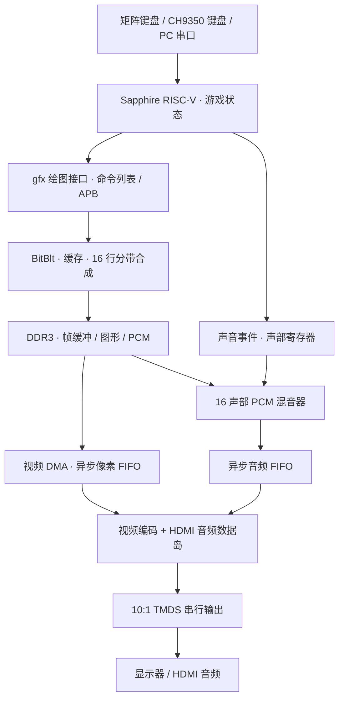
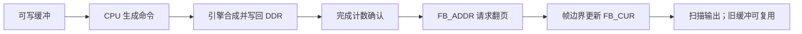

# Ti60 FPGA Game · V6 · 225 MHz

**中文** · [English](README_EN.md)

在易灵思 Titanium Ti60F225 上，把 RISC-V 软件中的游戏状态变成 HDMI 画面与声音：CPU 负责规则和绘图命令，FPGA 图形引擎负责合成，DDR 保存帧缓冲与素材，HDMI 电路按自己的节拍输出视频和音频。

当前仓库仅保留 **Ti60_V6_225M_CLEAN_20261101** 工程，内容直接放在仓库根目录，沿用原工程相对路径。硬件、软件、素材、上位机和配套下载文件属于同一份交付。版本与下载文件校验值见 [CURRENT_RELEASE.json](CURRENT_RELEASE.json)。

阅读顺序：[项目目标](#goals) → [演示功能](#demo) → [总体架构](#architecture) → [时钟与数据流](#clocks) → [软件帧循环](#frame-loop) → [图形引擎](#graphics) → [DDR 优化](#ddr) → [HDMI 音视频](#hdmi) → [输入与上位机](#input) → [游戏与素材](#assets) → [性能和验证](#validation) → [部署与后续改进](#deployment)。

<a id="goals"></a>
## 1. 项目目标

这个工程回答一个具体问题：**按下按键之后，角色的位置、技能和声音，怎样一步步成为显示器上的像素和扬声器中的采样？**

软件保存游戏状态和绘制顺序，硬件承担大量重复的拷贝、透明混合、写回和定时扫描。二者通过内存映射寄存器、DDR 命令列表、完成计数和 FIFO 协作。

目标器件为 `Ti60F225`，Efinity 时序模型为 `I3`。交付配置采用 225 MHz Sapphire RV32IM 系统、RGB565 帧缓冲、1280×720 HDMI 输出和 48 kHz 双声道音频。225 MHz 是核心配置频率；实际游戏呈现速度还受软件、DDR 和显示扫描共同约束。

<a id="demo"></a>
## 2. 演示功能

| 演示 | 可以观察什么 | 对应系统能力 |
| --- | --- | --- |
| 萝卜合作战役 | 六个场景、1～3 人、角色成长、Boss、大招、末关无尽波次 | 游戏逻辑、精灵与文字合成、事件音效 |
| 东方风格弹幕 | 弹幕、透明特效、场景音乐、压力档位 | 批量绘图、源缓存、CPU 与引擎并行 |
| 方块压力场景 | 大量矩形及半透明叠加 | FTAB 填充表、分带混合、带宽压力 |
| 图片切换 | RGB565 图片和整屏背景 | 大块拷贝、帧交换、扫描输出 |
| 上位机实验台 | 场景切换、输入控制、音量、统计和日志 | 串口协议、遥测、对照实验 |

萝卜、方块、图片使用原生 1280×720 绘制。弹幕保留 640×480 逻辑布局，可绘制为居中的 960×720 画面，两侧各补 160 像素装饰区；切换该绘制视图不会重新配置 HDMI 物理输出时序。


随工程提供的渲染预览；[大招演示视频](docs/demo/compact_ultimate_fx.mp4)。这些资料用于展示画面内容，不作为实板性能测量。

建议先用 Release ELF 体验游戏，再用 Debug ELF 观察性能。这里的 Debug/Release 主要区别是 `STATS=1/0` 测量开关；[构建脚本][build]为两者都使用优化构建 `DEBUG=no`。

<a id="architecture"></a>
## 3. 总体架构



视频和声音共享游戏状态与 DDR，但各自持续消费数据。软件一帧的绘制时间可以变化；HDMI 的行、帧和音频采样节拍必须连续，因此需要帧缓冲、完成确认和异步 FIFO。

| 部分 | 阅读入口 | 职责 |
| --- | --- | --- |
| 顶层 | [ddr3_example_top.v][top] | 连接 SoC、DDR、APB 外设、DMA 和 HDMI |
| 软件调度 | [main.c][main] | 初始化、输入、逻辑、绘制、呈现和统计 |
| 绘图前端 | [gfx.c][gfx]、[gfx_hw.c][gfx-hw]、[blit.c][blit-sw] | 同一绘图接口下的 CPU 与硬件后端 |
| 图形硬件 | [blit_engine.v][blit-rtl] | 命令执行、精灵缓存、分带合成 |
| 视频 | [hdmi_fb.v][hdmi-fb] | 帧地址交接、DDR 扫描、FIFO、视频时序 |
| 音频 | [audio_mixer.v][mixer]、[hdmi_island.v][island] | PCM 混音、采样节拍和 HDMI 数据包 |

APB 入口：HDMI `0xF8100000`，输入集线器 `0xF8100080`，BitBlt `0xF8101000`，混音器 `0xF8102000`。寄存器承载控制信息；像素、样本和大批量命令通过 DDR 传输。

<a id="clocks"></a>
## 4. 时钟与数据流

| 时钟域 / 节拍 | 当前配置 | 主要使用者 |
| --- | --- | --- |
| 板载参考 | 25 MHz | PLL 输入 |
| `core_clk` / `user_clk` | 225 MHz | CPU、图形引擎、DMA、混音器、输入逻辑 |
| `pll_fb_clk` | 100 MHz | DDR 控制器和 SoC 内存侧 |
| `sdram_clk` | 400 MHz | 16 位 DDR3 物理接口，双沿传输 |
| `hdmi_tx_slow_clk` | 74.375 MHz | 像素计数、数据岛和音视频编码 |
| `hdmi_tx_fast_clk` | 371.875 MHz | 半速率 DDR 串行器，10 bit / 像素 |
| 游戏逻辑目标 | 60 tick/s | 游戏更新、软件音量渐变 |
| 音频输出 | 48,000 个立体声采样帧/s | HDMI 音频消费端 |

依据为 [PLL 配置][peri]、[SDC 约束][sdc]、[BSP 时基][soc-h]及顶层参数。部分源码头部仍保留早期的 200 MHz、25 MHz 或 640×480 注释，理解当前实现时应结合实际传参。

视频总时序为 **1650×750**：水平 `1280+110+40+220`，垂直 `720+5+5+20`，所以扫描频率为 `74,375,000 / (1650×750) ≈ 60.101 Hz`。

SoC 的 AXI 跨域通路连接 225 MHz 系统与 100 MHz 内存侧。视频和音频分别通过异步 FIFO 进入像素域；帧边界、状态和复位也需要同步。

| DDR 地址 | 用途 |
| --- | --- |
| `0x00001000` 起，15 MiB | 程序、普通数据、BSS、栈 |
| `0x01000000` / `0x01200000` / `0x01400000` / `0x01C00000` | 四帧缓冲；每幅 1280×720×2 = **1,843,200 B** |
| `0x01600000` / `0x01800000` / `0x01A00000` / `0x01E00000` | 图片演示缓冲 |
| `0x02000000` 起，16 MiB 区域 | `.sound` PCM 声音库 |
| `0x03000000` 起 | 分带命令 bin；每带预留 `2^18` B |
| `0x04000000` 起，32 MiB | `.artbss` 运行时素材，启动后解压或生成，ELF 中为 NOLOAD |
| `0x06000000` 起，16 MiB | `.bg_assets` 压缩图形素材，由 ELF 下载 |

完整链接布局见 [game.ld][linker]，帧缓冲选择见 [main.c][main]。

<a id="frame-loop"></a>
## 5. 软件帧循环

[main.c][main]中的一帧按以下阶段推进：

1. **选择可写缓冲。** 排除 HDMI 正扫描的 `FB_CUR`、最近请求显示的 `last_req`、引擎尚未完成的 `pend_fb`。四块缓冲的职责随运行轮换。
2. **输入与逻辑。** 各输入源转换成统一动作；`run_logic()`推进游戏、碰撞、升级及声音事件。
3. **描述画面。** `th_render()`、`render_game()`或演示函数调用 `gfx_*`。CPU 后端直接写像素，硬件后端生成有序命令。
4. **结束提交。** `gfx_end()`结束列表或分带帧。命令已交出，不等于 DDR 中画面已完成。
5. **确认完成。** 普通路径等待引擎空闲；分带流水用 `blit_band_done()`确认对应序号的帧已写回。
6. **请求显示。** `present()`在需要时等上一次翻页生效，`hdmi_flip()`执行 memory fence 并写 `FB_ADDR`。
7. **硬件交接。** HDMI 在垂直同步脉冲结束的帧边界更新 `FB_CUR`、清除 `flip_pending`，预取下一帧。



默认 `VPIPE=1`。一帧若是完整且未被列表回绕拆开的 `BANDS…ENDB`，CPU 可准备下一帧，引擎同时处理上一帧。另一个 `overlap` 开关允许先提交当前状态的画面，再在引擎运行时执行逻辑更新。这些重叠改变输入到画面的延迟，完成确认和缓冲归属仍必须正确。

逻辑目标 60 tick/s、扫描约 60.101 Hz、渲染循环速度随工作量变化。低帧率时主循环会调整落后的 tick 计划，不会无限追赶所有错过的 tick，因此三种频率要分开观察。

<a id="graphics"></a>
## 6. 图形引擎

[BitBlt 引擎][blit-rtl]支持 RGB565 填充与拷贝、透明色键、全局 alpha、A8 alpha 和加法混合。CPU 可逐条写 APB，也可生成 DDR 命令列表；`SLOT/DRAW`复用精灵描述，`TAB`读取精灵表，`FTAB`批量处理矩形。

分带模式先按命令触及的水平带归类，再按原顺序合成：

```text
一帧命令 → 45 个带的命令 bin → 每次合成 1280×16 像素 → 连续写回 DDR
```

片上窗口只有 `1280×16×2 = 40,960 B`，无需容纳整幅 1.84 MB 帧缓冲。每带从黑色开始，背景必须明确绘制；多层混合在窗口内完成后再写回。跨带精灵进入多个 bin，因此命令归类也有开销。

| 路径 | 典型工作 | 作用 |
| --- | --- | --- |
| 128 位宽路径 | 满足对齐和尺寸条件的不透明拷贝 / 填充 | 每拍传 8 个 RGB565 像素 |
| K 路径 | 分带内缓存精灵、填充、支持的全局 alpha / 加法混合 | 并行处理 8 像素，减少逐精灵 DDR 写入 |
| 窄路径 | A8 等不满足快速路径条件的操作 | 保留完整混合功能 |
| 16 KiB 源缓存 | 重复使用的小精灵、字形 | 命中时无需读取 DDR 源数据 |

源缓存为 512 条、每条 32 B，直接映射。CPU 改写源图后需显式失效缓存；引擎不自动监听 CPU 写入。它与 CPU 的 16 KiB 指令缓存、32 KiB 数据缓存是不同部件。

<a id="ddr"></a>
## 7. DDR 优化

优化围绕访问形态展开，见 [blit_axi_wide.v][wide]、[blit_axi_rd_arb.v][arb]和引擎队列控制。

- **提前打包为 128 位。** 普通 32 位数据在 SoC 跨域 FIFO 之前打包；宽路径直接传 128 位。写地址通常等完整 burst 数据进入下游 FIFO 后释放，并保留提前发地址的回退逻辑。
- **短而连续的 burst。** 最多 64 个 32 位 word 对应 16 个 128 位 beat，传输不跨 256 B 块边界。
- **先供给扫描。** 视频优先于音频，二者共享读通路又优先于图形引擎普通读请求。已选择但未握手的请求保持选择，保证 AXI 信号稳定。
- **限制在途读取。** 默认 `LIMITW=64`，即普通读路径限额为 64 个 32 位 word；宽路径另有控制。限制引擎排队量可缩短后来 CPU 访问的等待。
- **减少重复读写。** 片上分带完成目标混合，缓存复用源图，列表降低逐寄存器提交成本。

CPU 取指、游戏状态、音频和视频都要访问 DDR；加深所有队列并不必然提升整体速度，需要结合队列等待、缓存命中和欠流计数调节。

按当前扫描时序，仅读取可见帧缓冲约需 **110.78 MB/s**。若每次扫描都生成完整新画面，写回还需约 110.78 MB/s，尚未计背景源读取、精灵、bin、CPU 和音频。16 位 DDR3 在 400 MHz 双沿传输下的物理理论值是 1.6 GB/s，刷新、行切换、读写转换和仲裁会降低有效带宽。

<a id="hdmi"></a>
## 8. HDMI 音视频

**一帧画面出板。** [hdmi_fb.v][hdmi-fb]对当前帧缓冲发起 DMA，把 RGB565 word 放入异步 FIFO。720p 配置使用 2048×32 bit 像素 FIFO。像素域按行列计数取像素、扩展 RGB 分量，生成视频区、消隐和同步，再进行 TMDS 编码。四组 10:1 输出分别承载时钟与三路数据。

**一段声音出板。** 射击、受伤、Boss 或 BGM 切换产生事件，[game_sound.c][game-sound] / [th_sound.c][th-sound]调用 [audio.c][audio-sw]，查找声音库条目并设置声部地址、长度、格式、音高、左右音量和循环点。

```text
游戏事件 → 声部 KEYON → DDR PCM → 插值 / 音量 / 累加 / 饱和
        → 16 位立体声 FIFO → 48 kHz 消费 → HDMI 音频包 → 显示器音频
```

[混音器][mixer]有 16 个声部，支持 s8 单声道、s16 单声道和 s16 立体声。每声部有两条 32 B 样本缓存，用 4.12 步长和线性插值适配源采样率。声部 0、1 用于 BGM，其余用于音效；软件控制切歌、淡出，硬件持续逐采样混音。

混音器按 FIFO 水位补样本，默认目标 64 个立体声采样帧，约 **1.33 ms**。这只是目标排队深度，完整声音延迟还包括事件调度、取样和显示器处理。

[hdmi_island.v][island]在消隐期发送 Audio Sample Packet、ACR、AVI InfoFrame、Audio InfoFrame，并生成 BCH 校验、TERC4 和保护带。当前 `N=6144`、`CTS=74375`：

```text
fs = 74,375,000 × 6144 / (128 × 74,375) = 48,000 Hz
```

音频采样率因此不随软件帧率改变。软件慢时画面可以重复，硬件仍继续混音和发包；供给不足时，应检查视频 `UF_CNT`、音频 `AUD_R_UF`和混音器统计。

<a id="input"></a>
## 9. 输入与上位机

[input_hub.v][input-rtl]负责矩阵扫描与 CH9350 UART，[input_devices.c][input-sw]解析按键快照和 `57 AB` 键盘报告，经 [input_link.h][input-link]转换成游戏动作。矩阵输入包含去抖、鬼键抑制和逐键映射校准。

| 人数 | 输入归属 |
| --- | --- |
| 1 人 | P1 合并 PC 串口 / 上位机、USB 键盘、矩阵键盘 |
| 2 人 | P1 使用 PC；P2 合并 USB 与矩阵键盘 |
| 3 人 | P1 使用 PC；P2 使用 CH9350 USB 键盘；P3 使用矩阵键盘 |

矩阵常用键：S2/S5/S6/S7 移动，S3 确认 / 开始，S8 大招，S9～S11 升级选项，S12 人数，S13 暂停，S14 重开确认，S16 冲刺或弹幕慢速。完整定义见 [matrix_keys.def][keys]；Fn+S12、Fn+S15 当前保留但未实现。

上位机由本地 Python HTTP 服务和浏览器组成，经 **115200 baud** 串口发送 `:id command [value]`加换行的命令，展示实际呈现率、逻辑 / 提交 / 等待耗时、音视频欠流，并保存日志和 CSV。服务绑定 `127.0.0.1`、默认自动选空闲端口，启动后在页面选择串口并连接。

- Windows：双击 [Start_Control_Panel.cmd](Start_Control_Panel.cmd)，使用便携 Python；默认日志在 `%LOCALAPPDATA%\Ti60V6\logs`。
- Linux：`bash Start_Control_Panel.sh`，需要 Python 3.10+，使用工程内 pySerial。
- 在上位机打开接线和按键页面。接线说明记录了厂商 J7 表的差异，应结合[引脚配置][peri]及逐键诊断核对实际接线；说明引用的历史 PDF 未随此精简工程提供。

上位机负责控制与观测；ELF 下载后，板上的游戏、渲染和 HDMI 音视频可自行运行。

<a id="assets"></a>
## 10. 游戏与素材

战役顺序为 `MOSS COURT`、`JADE PALACE`、`THUNDER CITY`、`EMBER PALACE`、`ASTRAL SANCTUM`、`TWIN DRAGONS`。前五关有 60 秒预算、40 秒最早过关门槛，末关为 50 秒波次的无尽模式。计时使用匹配 225 MHz 的时基，暂停和场景状态影响有效战役时间。

当前预留 384 个敌人槽、每玩家 160 个子弹槽，敌方弹幕最多 32768 槽供压力场景使用。这些是容量配置，不代表每个场景同时使用的数量或满负载帧率。规则与容量见 [game.c][game]、[game.h][game-h]、[sprout_config.h][config]。


*随工程提供的 V6 大招头像素材预览。*

| 素材 | 离线阶段 | 板上阶段 |
| --- | --- | --- |
| 背景、角色、大招、字体 | PNG / RGBA → RGB565、色键或 A8 → 必要时 LZ4 → C 数据 | ELF 下载只读素材；启动后解压 / 生成到 `.artbss`，绘图命令引用 |
| BGM、音效、配音 | WAV + [sounds.txt][sounds] → `wav2bank.py` → `sound_bank.bin` / `.S` | ELF 下载到 `0x02000000`，驱动按名字查条目，混音器读取 PCM |

图形脚本在 [tools](tools/)，包括 `build_campaign_art.py`、`build_v5_art.py`、`build_v6_art.py`、`build_ultimate_spirits.py`。声音转换器在[软件工程 tools][sound-tools]。当前生成数据已保留，普通编译无需重跑素材转换；修改源图 / WAV 时才重跑对应脚本并重建 ELF。

`assets/v4`、`v5`、`v6`是当前素材的来源目录，不是多个可选硬件工程。第三方运行时和字体的许可证随文件保留。

<a id="validation"></a>
## 11. 性能和验证

先区分“算得快”与“显示了新画面”。HDMI 约 60.101 Hz 扫描可以重复同一缓冲；解除同步后渲染 FPS 也可能高于实际呈现 FPS。

| 指标 | 回答的问题 |
| --- | --- |
| `render_fps` / `logic_hz` / `present_fps` / `scan_hz` | 提交画面、更新游戏、换上新画面和扫描各有多快 |
| `logic` / `submit` / `qstall` / `tail_wait` / `vsync_wait` | CPU、提交、队列、引擎尾部、翻页各花多久 |
| 缓存命中、读写 beat、分带 phase / flush | DDR 和片上合成开销在哪里 |
| 视频 / 音频欠流、bin 溢出、混音 clipping | 输出连续性、命令容量和音量是否正常 |
| 最大工作时间、超过 16.7 ms 的帧 | 平均帧率之外是否存在突发卡顿 |

Debug ELF 提供启动测速、详细统计和对照开关；Release ELF 关闭大部分测量开销。对比 CPU/硬件、缓存、分带和流水时，应固定场景、输入、人数、压力档并记录 BIT/ELF 哈希。

本次仓库整理已完成以下检查：

- 最终仓库共 712 个文件，运行源码、素材和下载文件沿用指定工程；更新中英文说明与入口，保留随工程新增的讲解、演示和验证资料。
- BIT、Debug ELF、Release ELF、声音库 SHA-256 及源码摘要均与 `CURRENT_RELEASE.json` 一致；两份 ELF 的程序、声音、图形加载段完整。
- 46 项硬件工程文件引用、39 条声音素材、45 个 Python 文件语法检查通过。
- 两种语言各 12 章、目录 / 文件 / 锚点链接检查通过；上位机 9 个页面、资源和 API 入口返回成功，未打开串口设备。

此次不重新编译软件、综合、布局布线或烧录实板。

工程随附的已有验证摘要如下。本次检查核对了软件摘要中的源码 digest 和 ELF 哈希与当前交付一致，但没有重跑这些测试。

| 已有记录 | 记录的结果 | 范围 |
| --- | --- | --- |
| [时序摘要](docs/evidence/timing_summary.json) | 核心 setup +0.063 ns、hold +0.012 ns；列出的关系均通过 | 225 MHz 选定构建的摘要，余量较小；完整工具报告未打包 |
| [HDMI 同步构建](docs/evidence/hdmi_sync_build.json) | 1,237,587 个周期的 TMDS 对比与参考 R7 一致 | 一整帧 720p、彩条和双声道 1 kHz 测试音；实板音频记录为待用户确认 |
| [软件本机测试](docs/evidence/software_native.json) | 4 项测试、87 帧渲染、400 秒无尽模式、ASan/UBSan | 主机侧验证，`physical_board_tested=false` |
| [软件交付核验](docs/evidence/software_payload.json) | 当前源码摘要、两份 ELF 哈希、384 敌人槽及素材保持情况 | 对应当前软件交付；`physical_board_tested=false` |

`verified_225`是原交付目录名。已有摘要中的绝对路径指向原构建环境；本仓库可用的下载入口是 `BOARD_TEST/verified_225/`。上文时钟、容量和理论带宽来自配置与计算，已有摘要不构成所有压力档持续 FPS 或所有 HDMI 显示器兼容性的保证。

<a id="deployment"></a>
## 12. 部署与后续改进

```text
.
├── README.md / README_EN.md       中英文架构与部署说明
├── CURRENT_RELEASE.json          BIT / ELF 信息与 SHA-256
├── BOARD_TEST/verified_225/       1 份 BIT + Debug / Release ELF
├── rtl/                          DDR、图形、HDMI、音频、输入 RTL
├── par/ddr_demo_ti60/             Efinity 工程、引脚、约束、SoC IP
│   └── embedded_sw/soc/           RISC-V 游戏、BSP、驱动、链接脚本
├── assets/                       当前图像、配音母版及派生素材
├── docs/                         随工程提供的演示资料与验证摘要
└── tools/                        素材工具、构建工具、上位机和运行时
```

**使用交付文件：**

1. 获取完整仓库并保持相对路径，准备 Ti60F225 板、JTAG、HDMI 显示设备及输入设备。
2. 使用 Efinity 2026.1 系列工具，工程记录版本为 `2026.1.132.4.5`。在 Efinity Programmer 加载 [225 MHz BIT][bit]。
3. 通过 Efinity RISC-V IDE 完整下载 [Release ELF][release-elf]用于演示，或 [Debug ELF][debug-elf]用于测量。包含全部可加载段，尤其是 `0x02000000`声音区、`0x06000000`图形区；`.artbss`在启动后构建。
4. 运行程序，确认 HDMI 画面和声音，再用上位机连接 115200 串口检查身份、分辨率、输入及欠流。
5. 按 [CURRENT_RELEASE.json](CURRENT_RELEASE.json)核对下载文件，使用同一份 225 MHz BIT/ELF 组合。

**重建源码：** 硬件打开 [ddr_demo_ti60.xml][project]；软件在 RISC-V IDE 导入 `par/ddr_demo_ti60/embedded_sw/soc/software/standalone/game`下的现有工程。也可从仓库根目录运行：

```bash
python3 tools/build_verified.py --toolchain /path/to/efinity-riscv-toolchain --profile 225
```

工具链目录应含 `bin/riscv-none-elf-gcc`，或直接指向编译器所在目录，系统还需 `make`。Windows 使用对应 Python、编译器和 make 环境运行同一脚本。它生成 `build/`、`build_release/`并同步两份 ELF 到 `BOARD_TEST/verified_225/`，不烧录硬件。自行改动或重建后应重新核对并更新发布清单的哈希。

配套说明：[现场讲解稿](docs/EXPLANATION_GUIDE.md)、[性能记录模板](docs/PERFORMANCE_RECORD_TEMPLATE.csv)、[About 文案](docs/GITHUB_ABOUT.txt)。讲解稿与历史文档整理记录是补充资料，当前发布入口和验证结果以本 README 及英文版为准。

后续改进沿数据流展开：保存完整 225 MHz 时序和资源报告；补充帧交换、AXI 背压和音频跨域的可重复仿真；用固定输入记录逐帧呈现和欠流；降低命令 bin 与源素材带宽；在更多 HDMI 接收端验证时序、ACR 和音频；完善资产生成依赖和接线资料，使新机器上的部署更容易复现。

[top]: rtl/ddr3_example_top.v
[project]: par/ddr_demo_ti60/ddr_demo_ti60.xml
[peri]: par/ddr_demo_ti60/ddr_demo_ti60.peri.xml
[sdc]: par/ddr_demo_ti60/sdc/ddr3.sdc
[soc-h]: par/ddr_demo_ti60/embedded_sw/soc/bsp/efinix/EfxSapphireSoc/include/soc.h
[main]: par/ddr_demo_ti60/embedded_sw/soc/software/standalone/game/src/main.c
[gfx]: par/ddr_demo_ti60/embedded_sw/soc/software/standalone/game/src/gfx.c
[gfx-hw]: par/ddr_demo_ti60/embedded_sw/soc/software/standalone/game/src/gfx_hw.c
[blit-sw]: par/ddr_demo_ti60/embedded_sw/soc/software/standalone/game/src/blit.c
[blit-rtl]: rtl/blit/blit_engine.v
[wide]: rtl/blit/blit_axi_wide.v
[arb]: rtl/blit/blit_axi_rd_arb.v
[hdmi-fb]: rtl/hdmi/hdmi_fb.v
[island]: rtl/hdmi/hdmi_island.v
[mixer]: rtl/audio/audio_mixer.v
[audio-sw]: par/ddr_demo_ti60/embedded_sw/soc/software/standalone/game/src/audio.c
[game-sound]: par/ddr_demo_ti60/embedded_sw/soc/software/standalone/game/src/game_sound.c
[th-sound]: par/ddr_demo_ti60/embedded_sw/soc/software/standalone/game/src/th_sound.c
[input-rtl]: rtl/input/input_hub.v
[input-sw]: par/ddr_demo_ti60/embedded_sw/soc/software/standalone/game/src/input_devices.c
[input-link]: par/ddr_demo_ti60/embedded_sw/soc/software/standalone/game/src/input_link.h
[keys]: tools/control_panel/matrix_keys.def
[game]: par/ddr_demo_ti60/embedded_sw/soc/software/standalone/game/src/game.c
[game-h]: par/ddr_demo_ti60/embedded_sw/soc/software/standalone/game/src/game.h
[config]: par/ddr_demo_ti60/embedded_sw/soc/software/standalone/game/src/sprout_config.h
[linker]: par/ddr_demo_ti60/embedded_sw/soc/software/standalone/game/game.ld
[sounds]: par/ddr_demo_ti60/embedded_sw/soc/software/standalone/game/sound/sounds.txt
[sound-tools]: par/ddr_demo_ti60/embedded_sw/soc/software/standalone/game/tools/
[build]: tools/build_verified.py
[bit]: BOARD_TEST/verified_225/ti60_v6_225m_hdmi_audio_sync_fix.bit
[debug-elf]: BOARD_TEST/verified_225/ti60_verified_225_debug.elf
[release-elf]: BOARD_TEST/verified_225/ti60_verified_225_release.elf
