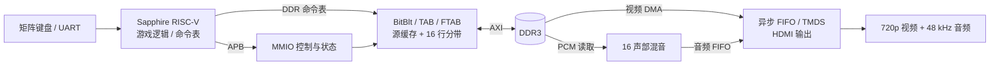

# Ti60 FPGA 2D Graphics Accelerator | RISC-V SoC

[中文](README.md) · [English](README_EN.md) · [Efinity 工程](par/ddr_demo_ti60/ddr_demo_ti60.xml) · [技术验证](docs/07_VERIFICATION.md)

> **定位：** 基于 Ti60F225 / Sapphire RV32IM 的 FPGA 二维图形加速、共享 DDR3 和 HDMI 音视频 SoC 实践。游戏仅作为可重复的硬件负载，不是仓库的技术主体。

## 1. 系统摘要

- **器件/工具：** Efinix Titanium Ti60F225，timing model I3，Efinity 2026.1.132。
- **时钟/输出：** RISC-V 与图形逻辑 225 MHz；RGB565 1280×720 HDMI 扫描约 60.10 Hz；48 kHz 双声道 PCM。
- **软硬件分工：** RV32IM 完成输入与场景状态、构造 TAB/FTAB 对象表；FPGA 执行命令读取、DMA、色键/Alpha 混合、分带合成和帧缓冲写回。
- **关键优化：** 16 B 弹幕热数据、16 KiB 直接映射源缓存、45 个 1280×16 横带、最高 8 像素/拍的特定并行通路、四帧缓冲。
- **外设：** DDR3、APB 寄存器、AXI 读写通路、HDMI 音视频、16 声部混音、矩阵键盘、CH9350 UART、PC 串口遥测。

这些是当前工程设计参数或既有报告指标；**并不等于已经在此分支重新综合、实测或证明任意场景稳定 60 FPS**。



## 2. 代码导航

| 部分 | 实现入口 | 关注点 |
|---|---|---|
| 顶层集成 | [ddr3_example_top.v](rtl/ddr3_example_top.v) | 时钟、复位、APB、AXI、DDR、音视频互连 |
| 图形引擎 | [blit_engine.v](rtl/blit/blit_engine.v) | 命令队列、LIST/TAB/FTAB、源缓存、分带合成 |
| 宽突发通路 | [blit_axi_wide.v](rtl/blit/blit_axi_wide.v) | 128-bit 数据搬运、突发写回 |
| 读仲裁 | [blit_axi_rd_arb.v](rtl/blit/blit_axi_rd_arb.v) | 扫描优先、背压时锁定授予、RID 回程分流 |
| HDMI / 音频 | [hdmi_fb.v](rtl/hdmi/hdmi_fb.v)、[hdmi_island.v](rtl/hdmi/hdmi_island.v)、[audio_mixer.v](rtl/audio/audio_mixer.v) | 帧边界翻页、跨时钟 FIFO、PCM 混音 |
| 板端固件 | [main.c](par/ddr_demo_ti60/embedded_sw/soc/software/standalone/game/src/main.c)、[gfx_hw.c](par/ddr_demo_ti60/embedded_sw/soc/software/standalone/game/src/gfx_hw.c) | 四帧调度、统一绘图 API、命令提交 |
| 软件/RTL 契约 | [blit.h](par/ddr_demo_ti60/embedded_sw/soc/software/standalone/game/src/blit.h) | APB 偏移、命令格式、同步边界 |
| 工程/约束 | [ddr_demo_ti60.xml](par/ddr_demo_ti60/ddr_demo_ti60.xml)、[ddr3.sdc](par/ddr_demo_ti60/sdc/ddr3.sdc) | 源文件清单、PLL、时序约束 |

**代码来源与边界：** 自研图形/音频/输入 RTL 与板端应用在本项目中集成；DDR3/SoC IP 和部分 TMDS 编码源于厂商或示例。请遵循仓库中对应第三方文件的原许可及归属，不将其描述为自研。

## 3. 技术文档（按技术报告的模块顺序）

| 文档 | 主要内容 |
|---|---|
| [01 系统与时钟](docs/01_SYSTEM_ARCHITECTURE.md) | SoC 拓扑、时钟域、内存映射、软硬件职责 |
| [02 BitBlt 数据通路](docs/02_BITBLT_PIPELINE.md) | 三条执行通路、分桶/带内合成、源缓存、完成协议 |
| [03 AXI/DDR](docs/03_AXI_DDR_INTERFACE.md) | 访存仲裁、带宽预算、突发边界、背压 |
| [04 HDMI/音频](docs/04_HDMI_AUDIO.md) | 扫描、垂直同步翻页、音频数据岛与 FIFO |
| [05 固件 ABI](docs/05_FIRMWARE_ABI.md) | APB 地址、绘图表项、缓存一致性、帧缓冲所有权 |
| [06 构建与下载](docs/06_BUILD_AND_FLASH.md) | 环境、构建脚本、位流/ELF 配对和恢复 |
| [07 验证](docs/07_VERIFICATION.md) | 独立 Testbench、验证矩阵、检查与证据边界 |
| [08 PPA / 负载](docs/08_PPA_RESULTS.md) | 资源、时序、弹幕/透明方块基准与测量口径 |

## 4. 验证与性能记录

| 既有技术报告结果 | 数值 | 证据边界 |
|---|---|---|
| XLR | 56,479 / 60,800（92.89%） | 指定 225 MHz 构建的资源截图 |
| 片上 RAM | 250 / 256（97.66%） | 容量接近上限，结构变更需重新检查 |
| DSP | 56 / 160（35%） | 原报告记录 |
| 核心 setup / hold | +0.063 ns / +0.012 ns | 指定报告的静态时序，不等于所有实板条件的保证 |
| 9×9 弹幕，约 1.54 万目标 | 15,395 活跃；60 帧/s；16.11 ms | 报告中指定测试场景与条件 |

完整表格与出处见 [08 PPA / 负载](docs/08_PPA_RESULTS.md)，机读摘要见 [docs/evidence](docs/evidence/README.md)。必须区分逻辑更新率、渲染率、真正的 `present_fps` 和 HDMI 固定扫描率；容量上限不能冒充稳定帧率。

## 5. 最小复现入口

1. 使用 Efinity 2026.1，打开 [工程 XML](par/ddr_demo_ti60/ddr_demo_ti60.xml)，确认 Ti60F225 I3 与 [PERI/SDC](par/ddr_demo_ti60/) 文件完整；SoC IP 依赖 Efinity 环境。
2. 在本地执行 `python3 tools/check_repo.py --hash` 检查工程文件引用及交付 BIT/ELF/声音库哈希。该步骤**不是**综合或烧录。
3. 需要复编固件时使用 [build_verified.py](tools/build_verified.py) 与兼容 RISC-V GCC（参见 [06](docs/06_BUILD_AND_FLASH.md)）。
4. 已交付的 BIT/Debug ELF/Release ELF 见 [BOARD_TEST/verified_225](BOARD_TEST/verified_225/)；按照 [CURRENT_RELEASE.json](CURRENT_RELEASE.json) 配对下载。**仅下载位流不足以运行 DDR 内的完整游戏固件与素材。**
5. 可选 PC 遥测：Linux `bash Start_Control_Panel.sh`；Windows `Start_Control_Panel.cmd`。上位机不是游戏运行前提。
6. 单元仿真入口：`bash verification/axi_read_arb/run.sh`（需要 Icarus Verilog）；完整 SoC 验证仍需厂商 IP/时序仿真和实板检查。

本次仓库重构只调整文档、仓库治理和独立验证材料，**不修改功能 RTL、BSP、工程约束或交付二进制**；详见 [验证范围](docs/07_VERIFICATION.md)。

## 6. 工程目录约定

```text
rtl/                     自研硬件模块与集成所需 DDR3/示例 RTL
par/ddr_demo_ti60/       可打开的 Efinity 项目 / SoC IP / BSP / 裸机游戏工程
tools/                   素材构建脚本与串口遥测上位机
assets/                  版本化素材输入（修改固件素材需要它们）
BOARD_TEST/verified_225/ 当前配套 BIT 与 ELF（后续可转 GitHub Release）
verification/            可独立运行的 RTL Testbench 与测试说明
docs/                    技术规格、验证口径及选定证据
CURRENT_RELEASE.json     交付哈希、软件版本与硬件配对元数据
```

**为什么没有把所有“看起来旧”的源文件删除？** `rtl/memory_test/` 等内容仍在 Efinity XML 的综合文件清单中；未经等价的 Elaboration、PnR 和板级回归，删除会降低可复现性。运行时、素材和 ELF 也要先有经过验证的替代分发入口再迁出。
