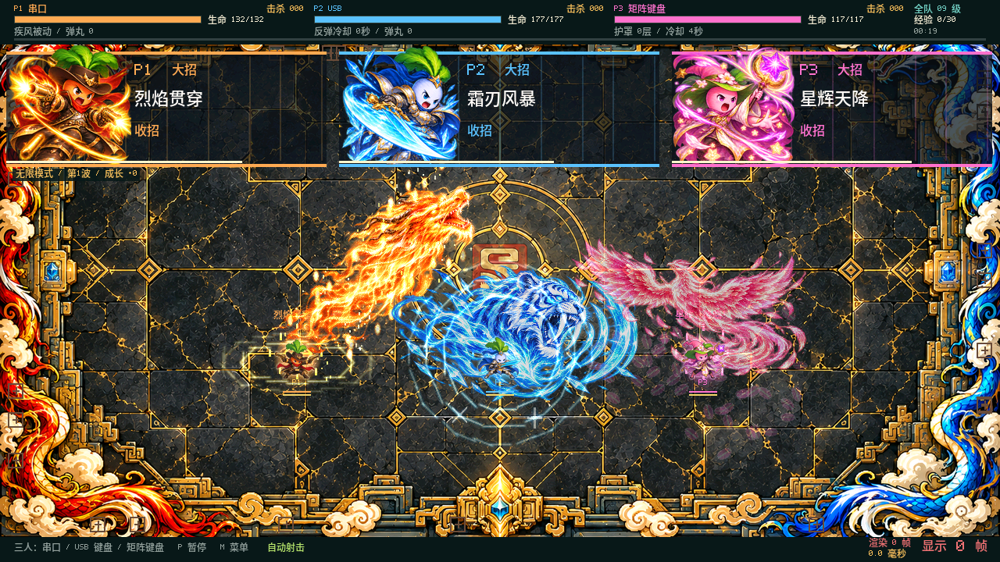
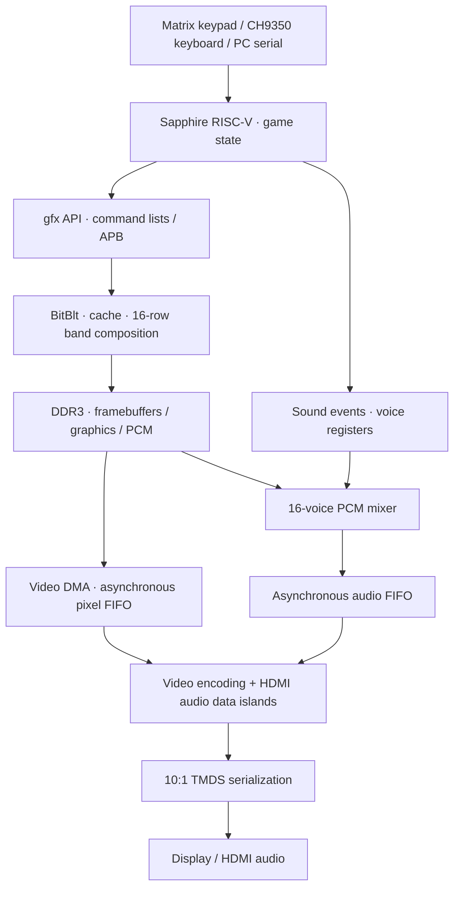
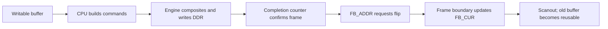
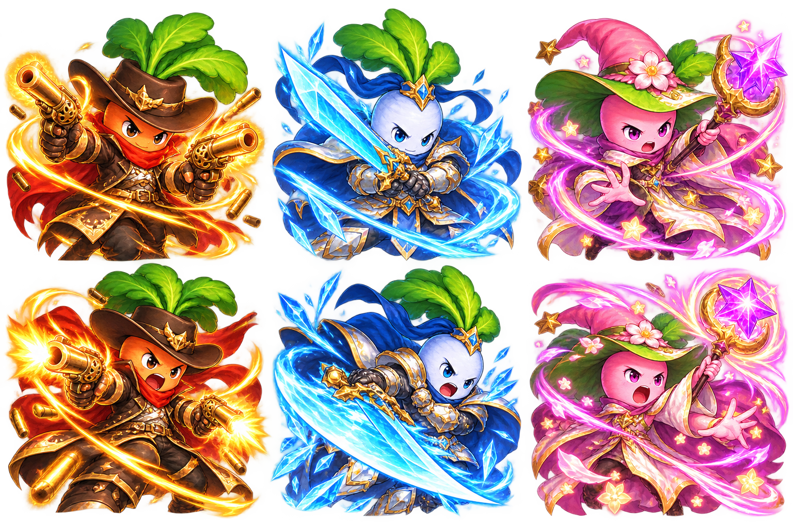

# Ti60 FPGA Game · V6 · 225 MHz

[中文](README.md) · **English** · [Run on board](#deployment) · [Presentation guide (中文)](docs/EXPLANATION_GUIDE.md) · [Source walkthrough (中文)](docs/RENDERING_WALKTHROUGH.md)

A system on the Efinix Titanium Ti60F225 that turns RISC-V software state into HDMI pictures and sound. The CPU runs game rules and describes drawing work, an FPGA graphics engine composites it, DDR stores framebuffers and assets, and HDMI hardware transmits video and audio at its own continuous cadence.

The repository uses **Ti60_V6_225M_CLEAN_20261101** as its project baseline, with its contents placed directly at the repository root and its relative paths preserved. Hardware, software, assets, the console, and programming files form one delivery. See [CURRENT_RELEASE.json](CURRENT_RELEASE.json) for the revision and programming-file checksums.

> **Current baseline:** 225 MHz core, 1280×720 RGB565 framebuffer, and 48 kHz stereo audio. Stress presets request a workload; sustained FPS needs board measurements under specified conditions. See [chapter 11](#validation) for the scope of existing timing and software evidence.

Reading order: [Project goals](#goals) → [Demonstrations](#demo) → [System architecture](#architecture) → [Clocks and data flow](#clocks) → [Software frame loop](#frame-loop) → [Graphics engine](#graphics) → [Submission, text, and DDR optimization](#ddr) → [HDMI video and audio](#hdmi) → [Input and host console](#input) → [Game and assets](#assets) → [Performance and validation](#validation) → [Deployment and future work](#deployment).

<a id="goals"></a>
## 1. Project goals

The project follows one concrete question: **after a key press changes a character's position, ability, or sound, how does that change become pixels on a display and samples at a speaker?**

Software maintains game state and drawing order. Hardware performs repeated copies, alpha blending, writeback, and timed scanout. Registers, DDR command lists, completion counters, and FIFOs connect the two.

The target device is `Ti60F225`, with Efinity timing model `I3`. The delivered configuration uses a 225 MHz Sapphire RV32IM system, RGB565 framebuffers, 1280×720 HDMI output, and 48 kHz stereo audio. The core frequency is a configuration value; actual presentation speed also depends on software, DDR, and scanout.

<a id="demo"></a>
## 2. Demonstrations

| Demonstration | What to observe | System capability |
| --- | --- | --- |
| Cooperative carrot campaign | Six scenes, 1–3 players, progression, bosses, ultimates, endless final-stage waves | Game logic, sprites and text, event sounds |
| Carrot projectile stress test | Fixed sprite sizes, requested counts, edge clipping | Stable draw tables, TAB submission, submission time and presentation |
| Touhou-style bullet hell | Separate single-player game, bullets, transparent effects and music | Shared graphics/audio interfaces and load control |
| Rectangle stress scene | Many rectangles and translucent layers | FTAB fill tables, band blending, memory pressure |
| Image switching | RGB565 images and full-screen backgrounds | Large copies, framebuffer handoff, scanout |
| Host console | Scenes, input, volume, counters, logs | Serial commands, telemetry, controlled comparisons |

The carrot game and its projectile stress test, rectangles, and images render at native 1280×720. The Touhou-style game retains a 640×480 logical layout and can render it as a centered 960×720 view with 160-pixel decorative margins on either side. Changing this drawing view does not reconfigure physical HDMI output timing.



The preview and [ultimate demonstration video](docs/demo/compact_ultimate_fx.mp4) come from host-side validation of the current C renderer, with fixed character positions to show the effects. They illustrate rendered content, not a board HDMI capture or measured board FPS. The image demo scans through four pictures in a loop, with the twin-dragon picture fourth.

Use the Release ELF for a demonstration and the Debug ELF for measurement. Here, Debug/Release primarily selects `STATS=1/0`; the [build script][build] uses optimized `DEBUG=no` builds for both.

<a id="architecture"></a>
## 3. System architecture



Video and audio share game state and DDR while consuming data independently. Software rendering time varies; HDMI lines, frames, and audio samples need a continuous cadence. Framebuffer ownership, completion checks, and asynchronous FIFOs make this possible.

| Part | Reading entry point | Responsibility |
| --- | --- | --- |
| Integration | [ddr3_example_top.v][top] | Connect SoC, DDR, APB peripherals, DMA, HDMI |
| Software scheduling | [main.c][main] | Initialize, collect input, update, draw, present, measure |
| Drawing frontend | [gfx.c][gfx], [gfx_hw.c][gfx-hw], [blit.c][blit-sw] | CPU and hardware backends behind one API |
| Graphics hardware | [blit_engine.v][blit-rtl] | Commands, sprite caching, band composition |
| Video | [hdmi_fb.v][hdmi-fb] | Frame handoff, DDR scanout, FIFO, timing |
| Audio | [audio_mixer.v][mixer], [hdmi_island.v][island] | PCM mixing, sample timing, HDMI packets |

APB entry addresses: HDMI `0xF8100000`, input hub `0xF8100080`, BitBlt `0xF8101000`, mixer `0xF8102000`. Registers carry control information; pixels, samples, and bulk commands travel through DDR.

<a id="clocks"></a>
## 4. Clocks and data flow

| Clock domain / cadence | Current configuration | Main consumers |
| --- | --- | --- |
| Board reference | 25 MHz | PLL inputs |
| `core_clk` / `user_clk` | 225 MHz | CPU, graphics, DMA, mixer, input logic |
| `pll_fb_clk` | 100 MHz | DDR controller and SoC memory side |
| `sdram_clk` | 400 MHz | 16-bit DDR3 physical interface, both edges |
| `hdmi_tx_slow_clk` | 74.375 MHz | Pixel counters, data islands, audio/video encoding |
| `hdmi_tx_fast_clk` | 371.875 MHz | Half-rate DDR serializer, 10 bits per pixel |
| Game update target | 60 ticks/s | Game updates, software fades |
| Audio output | 48,000 stereo sample frames/s | HDMI audio consumer |

Sources are the [PLL configuration][peri], [SDC constraints][sdc], [BSP timebase][soc-h], and top-level parameters. Some source headers still describe earlier 200 MHz, 25 MHz, or 640×480 configurations; inspect instantiated parameters when tracing this release.

Video totals are **1650×750**: horizontal `1280+110+40+220`, vertical `720+5+5+20`. The scan rate is `74,375,000 / (1650×750) ≈ 60.101 Hz`.

The software timebase is derived from BSP `SYSTEM_CLINT_HZ=225000000`: `TICKS_PER_US=225`, with a target logic period of `225000000/60=3750000` ticks. Converting a counter actually running at 225 MHz using a 200 MHz divisor overstates elapsed time by a factor of 1.125 and also distorts FPS and bandwidth statistics. After a clock change, check the BIT, BSP, software, and reported `core_hz` together.

The SoC AXI crossing connects the 225 MHz system to the 100 MHz memory side. Separate asynchronous video and audio FIFOs feed the pixel domain; frame events, status, and resets also need synchronization.

| DDR address | Use |
| --- | --- |
| `0x00001000`, 15 MiB region | Program, ordinary data, BSS, stack |
| `0x01000000` / `0x01200000` / `0x01400000` / `0x01C00000` | Four framebuffers; each 1280×720×2 = **1,843,200 B** |
| `0x01600000` / `0x01800000` / `0x01A00000` / `0x01E00000` | Image-demo buffers |
| `0x02000000`, 16 MiB region | `.sound` PCM bank |
| Starting at `0x03000000` | Band command bins, `2^18` B reserved per band |
| `0x04000000`, 32 MiB region | `.artbss` runtime assets, decoded/generated after startup; NOLOAD in ELF |
| `0x06000000`, 16 MiB region | `.bg_assets` compressed graphics, loaded with ELF |

See [game.ld][linker] for the full linked layout and [main.c][main] for framebuffer selection.

<a id="frame-loop"></a>
## 5. Software frame loop

The loop in [main.c][main] advances a frame through these stages:

1. **Choose a writable buffer.** Exclude the buffer being scanned (`FB_CUR`), the most recently requested buffer (`last_req`), and an unfinished engine frame (`pend_fb`). The four buffers rotate through these roles.
2. **Input and logic.** Convert device input to common actions. `run_logic()` advances gameplay, collisions, upgrades, and sound events.
3. **Describe the picture.** `th_render()`, `render_game()`, or demo functions call `gfx_*`. The CPU backend writes pixels; the hardware backend builds ordered commands.
4. **Finish submission.** `gfx_end()` closes the list or band frame. Submitted commands do not yet mean a complete picture in DDR.
5. **Confirm completion.** The ordinary path waits for engine idle. The band pipeline uses `blit_band_done()` to confirm writeback for a particular frame sequence.
6. **Request presentation.** `present()` waits for the previous flip when needed; `hdmi_flip()` issues a memory fence and writes `FB_ADDR`.
7. **Hand off in hardware.** At the end of the vertical-sync pulse, HDMI updates `FB_CUR`, clears `flip_pending`, and prefetches the next frame.



**Logic overlap is enabled by default, so the actual order is:** read input → submit the current state → update logic while the engine draws → wait for the frame due for presentation → request a flip. Disabling `overlap` selects the serial logic-before-render order. The two paths have different latency behavior.

The default is `VPIPE=1`. When a frame is a complete `BANDS…ENDB` sequence without a list-wrap split, the CPU can prepare the next frame while the engine processes the previous one. A separate `overlap` option submits the current picture first, then runs game logic while the engine works. Overlap changes input-to-picture latency; completion checks and buffer ownership remain necessary.

Logic targets 60 ticks/s, scanout runs at roughly 60.101 Hz, and rendering speed varies with workload. Under overload, the loop adjusts an overdue tick schedule instead of indefinitely replaying all missed ticks. Measure these rates separately.

<a id="graphics"></a>
## 6. Graphics engine

The [BitBlt engine][blit-rtl] supports RGB565 fills/copies, color keys, global alpha, A8 alpha, and additive blending. The CPU can write APB registers or build DDR command lists. `SLOT/DRAW` reuse sprite descriptions, `TAB` reads sprite tables, and `FTAB` batches rectangles.

Band mode bins commands by the horizontal bands they touch and then composites them in their original order:

```text
Frame commands → bins for 45 bands → compose 1280×16 pixels at a time → burst writeback
```

The on-chip window occupies `1280×16×2 = 40,960 B`, avoiding the need to hold the whole 1.84 MB framebuffer on chip. Each band starts black, so backgrounds must be explicitly drawn. Layers blend inside the window before writeback. Sprites crossing bands enter multiple bins, which also costs memory traffic.

| Path | Typical work | Role |
| --- | --- | --- |
| 128-bit wide path | Opaque copies/fills meeting alignment and size conditions | Eight RGB565 pixels per beat |
| K path | Cached sprites, fills, supported global-alpha/additive band blends | Eight parallel pixels with fewer per-sprite DDR writes |
| Narrow path | A8 and other operations outside fast-path conditions | Preserve complete blending functionality |
| 16 KiB source cache | Repeated small sprites and glyphs | Avoid DDR source reads on hits |

The source cache is direct mapped, with 512 lines of 32 B. CPU changes to cached source pixels require explicit invalidation; the engine does not snoop CPU writes. It is separate from the CPU's 16 KiB instruction cache and 32 KiB data cache.

### 6.1 A batched list is different from a hardware-read table

Although `gfx_blit_list()` separates in-bounds runs from clipped items, its `copy_list` backend still expands `DRAW` commands or register writes on the CPU. `gfx_blit_table()` lets hardware read a stable `GfxItem` array, reducing CPU submission to sprite-slot descriptions and table references. Table fetching, binning, and pixel processing still have costs.

`draw_seeds()` retains a single-TAB fast path when the whole table fits the current target. With clipped items, `gfx_blit_table_clipped()` preserves the original order:

```text
Input:  A and B in bounds; C clipped; D and E in bounds
Output: TAB(A,B) → existing single-item clipping for C → TAB(D,E)
```

Bounds checks use the current `gfx.width/height` and each sprite's actual dimensions. Fully off-screen items are ignored by the existing clipper. Each run accumulates its own pixel count and passes through `gfx_blit_table()` for mode, capability, and address checks, with fallback when necessary. A non-null `copy_table` pointer alone does not guarantee support. Global alpha uses the corresponding `*_alpha` path; A8 masks are not an implicit TAB feature.

TAB reads the original slices asynchronously, so their storage must remain valid after submission returns. Three rotating `seed_draw` tables work with completion-sequence waits in the main loop. The reusable `seed_list[128]` scratch buffer keeps its list-expansion path. See the [source walkthrough on clipping and lifetime (中文)](docs/RENDERING_WALKTHROUGH.md#ordered-tab).

<a id="ddr"></a>
## 7. Submission, text, and DDR optimization

### 7.1 Locate the expensive stage first

Separate logic, CPU submission, queue stalls, engine tail waits, and presentation synchronization before choosing an optimization. TAB reduces CPU command expansion, source caching avoids repeated source reads, and band composition reduces destination read-modify-write traffic. Improving one stage does not imply the same proportional improvement in complete-frame time.

### 7.2 Current text rendering paths

| Text | Current path | Consideration |
| --- | --- | --- |
| ASCII letters, numbers and symbols | Original 5×7 bitmap; keyed atlases at small scales, merged stroke runs at larger scales | Preserves the inexpensive path instead of converting everything to A8 |
| Chinese | Generated glyphs, A8 masks, and flat-color planes | Smooth edges require alpha operations |
| Repeated whole labels | The hardware backend can reuse label images; ASCII stays keyed and labels containing Chinese use A8 | Falls back to individual glyphs when allocation or eligibility checks fail |

Language changes retain completion waits and font-cache reset handling. Translation lookup checks string contents rather than relying on a reusable temporary pointer. New UI text uses these same paths. Initial cache construction, changing colors/scales/labels, and hardware queue pressure can all affect time; a HUD spike cannot be attributed entirely to glyph drawing.

**Measurement scope:** `hud_us` covers HUD and related interface drawing and may include waits inside that interval. `font_hit`, `font_miss`, `label_hit`, and related `C4` fields currently emit fixed zeros; they do not measure cache hit rates. See [gfx.c][gfx] and the [text walkthrough (中文)](docs/RENDERING_WALKTHROUGH.md#text-path).

### 7.3 Shape DDR access

Access shaping is implemented in [blit_axi_wide.v][wide], [blit_axi_rd_arb.v][arb], and the engine's queue controls.

- **Pack to 128 bits early.** Ordinary 32-bit data is packed before the SoC clock-crossing FIFO; the wide path transfers 128 bits directly. Write addresses normally wait for a complete burst in the downstream data FIFO, with an early-address fallback.
- **Use bounded contiguous bursts.** Up to 64 ordinary 32-bit words become 16 beats of 128 bits; bursts do not cross 256 B block boundaries.
- **Feed scanout first.** Video has priority over audio; their shared read path has priority over ordinary graphics reads. A selected request retains its grant until handshake to keep AXI signals stable.
- **Limit reads in flight.** The software default `LIMITW=64` allows 64 in-flight 32-bit words on the ordinary path; the wide path has separate controls. Bounding queued graphics traffic can reduce waits for later CPU accesses.
- **Avoid repeated traffic.** Compose destinations in the band window, cache source sprites, and batch commands instead of repeated register submissions.

Instruction fetch, game state, audio, and video all use DDR. Making every queue deeper does not necessarily improve the whole system; queue waits, cache hits, and underflows reveal the tradeoff.

At the configured scan rate, visible framebuffer reads alone require about **110.78 MB/s**. Producing a complete new picture for each scan adds roughly the same writeback rate, before background reads, sprites, bins, CPU traffic, and audio. The 16-bit DDR3 interface at 400 MHz on both edges has a theoretical physical rate of 1.6 GB/s; refresh, row changes, read/write direction changes, and arbitration reduce useful throughput.

<a id="hdmi"></a>
## 8. HDMI video and audio

**A picture leaves the board.** [hdmi_fb.v][hdmi-fb] reads the current framebuffer by DMA and puts RGB565 words into an asynchronous FIFO. The 720p configuration uses a 2048×32-bit pixel FIFO. Pixel-domain counters consume pixels, expand RGB components, generate active video, blanking, and synchronization, then encode TMDS. Four 10:1 outputs carry the clock and three data channels.

**A sound leaves the board.** Shots, damage, bosses, or BGM changes generate events. [game_sound.c][game-sound] / [th_sound.c][th-sound] call [audio.c][audio-sw], which finds a bank entry and programs the voice address, length, format, pitch, left/right volume, and loop point.

```text
Game event → voice KEYON → DDR PCM → interpolation / gain / sum / saturation
           → 16-bit stereo FIFO → 48 kHz consumption → HDMI packets → display audio
```

The [mixer][mixer] has 16 voices and supports s8 mono, s16 mono, and s16 stereo. Each voice has two 32 B sample-cache lines. A 4.12 step and linear interpolation adapt source sample rates. Voices 0 and 1 are used for BGM; the others are used for effects. Software manages track changes and fades while hardware keeps mixing samples.

The mixer refills according to FIFO occupancy. Its default target is 64 stereo sample frames, about **1.33 ms**. This is queue depth, not total sound latency; event scheduling, fetching, and receiver processing also contribute.

[hdmi_island.v][island] transmits Audio Sample Packets, ACR, AVI InfoFrames, and Audio InfoFrames during blanking, with BCH checks, TERC4 coding, and guard bands. The configuration uses `N=6144`, `CTS=74375`:

```text
fs = 74,375,000 × 6144 / (128 × 74,375) = 48,000 Hz
```

Audio sample rate therefore does not change with software FPS. A slow frame can repeat while mixing and packet transmission continue. If supply falls behind, inspect video `UF_CNT`, audio `AUD_R_UF`, and mixer statistics.

### 8.1 What changed in the HDMI synchronization bitstream

The delivered file is `ti60_v6_225m_hdmi_audio_sync_fix.bit`. The RTL and [build record](docs/evidence/hdmi_sync_build.json) identify two output changes:

- Audio Sample Packet SB6 groups the two channels' parity, channel-status, user, and validity bits as `{P_R,C_R,U_R,V_R,P_L,C_L,U_L,V_L}`.
- External VSYNC uses `vs_tx0`, whose edges align with HSYNC. Internal framebuffer handoff and DMA keep the existing vertical timing.

These changes do not replace the 48 kHz sample rate. The recorded TMDS comparison covers one full 720p frame with color bars and a stereo 1 kHz tone. Equality to R7 applies to that simulation scope; the record does not include receiver-side board audio acceptance results.

<a id="input"></a>
## 9. Input and host console

[input_hub.v][input-rtl] scans the matrix keypad and implements the CH9350 UART. [input_devices.c][input-sw] parses snapshots and `57 AB` keyboard reports; [input_link.h][input-link] turns them into game actions. Matrix handling includes debounce, ghost-key suppression, and per-key mapping calibration.

| Players | Input assignment |
| --- | --- |
| 1 | P1 combines PC serial / console, USB keyboard, and matrix keypad |
| 2 | P1 uses the PC; P2 combines USB and matrix input |
| 3 | P1 uses the PC; P2 uses the CH9350 USB keyboard; P3 uses the matrix keypad |

Common matrix controls: S2/S5/S6/S7 move, S3 confirms/starts, S8 activates an ultimate, S9–S11 select upgrades, S12 selects player count, S13 pauses, S14 requests restart confirmation, and S16 dashes or slows bullet-hell movement. See [matrix_keys.def][keys] for the full mapping; Fn+S12 and Fn+S15 remain reserved and unimplemented.

The console uses a local Python HTTP server and browser UI. It sends `:id command [value]` followed by a newline over **115200-baud** serial, displays actual presentation rates, logic/submission/wait time and underflows, and saves logs and CSV. It binds to `127.0.0.1` and automatically chooses a free port by default. Select and connect a serial port in the page after startup.

- Windows: run [Start_Control_Panel.cmd](Start_Control_Panel.cmd), using bundled portable Python. Default logs go to `%LOCALAPPDATA%\Ti60V6\logs`.
- Linux: run `bash Start_Control_Panel.sh` with Python 3.10+ and the project's bundled pySerial.
- Open the console's wiring and key-help pages. Wiring notes record conflicting manufacturer J7 tables; use the [pin configuration][peri] and individual-key diagnostics to confirm actual wiring. Historical PDFs referenced there are not included in this compact project.

The console controls and observes the system. After ELF download, gameplay, rendering, and HDMI audio/video run on the board itself.

### 9.1 Stress presets for 225 MHz

[r2_presets.py][presets] scales the original counts by 1.1 and rounds down to a multiple of 100 using integer arithmetic: `original * 11 // 1000 * 100`. A scaled value of 11111 becomes 11100. The 25 px carrot target was subsequently overridden to **11,000**, replacing the formula's 9,000.

| Carrot sprite size | Requested count | Rectangle size | Requested count |
| ---: | ---: | ---: | ---: |
| 1 px | 16,200 | 1 px | 35,200 |
| 3 px | 16,000 | 3 px | 34,100 |
| 6 px | 15,600 | 6 px | 33,000 |
| 9 px | 15,400 | 8 px | 31,900 |
| 13 px | 15,000 | 12 px | 30,800 |
| 17 px | 14,900 | 16 px | 29,700 |
| 25 px | 11,000 | 24 px | 20,900 |
| — | — | 32 px | 13,800 |
| — | — | 40 px | 9,700 |
| — | — | Random 6–40 px | 20,100 |

These are **requested workloads**. The hostile-projectile pool holds 32,768 entries and the rectangle capacity is 35,200; active counts and sustained presentation rates need runtime measurements. The clock ratio `225/200=1.125` does not prove a 12.5% system speedup, and the preset multiplier 1.1 is not a measured acceleration ratio.

After applying a preset, confirm command ACKs and then check `core_hz`, scene, size, count, and `band/cache/overlap` in a fresh telemetry window. `M4/F4/P4/C4` share `seq` for one window, while `epoch` identifies configuration changes. Do not combine measurements from before and after a switch.

<a id="assets"></a>
## 10. Game and assets

### 10.1 Six-scene progression and endless waves

| Scene | Levels | Scene boss family |
| --- | --- | --- |
| MOSS COURT | 1–3 | ANCIENT ROOT KING |
| JADE PALACE | 4–5 | JADE QILIN |
| THUNDER CITY | 6 | THUNDER ENGINE |
| EMBER PALACE | 7 | EMBER PHOENIX |
| ASTRAL SANCTUM | 8 | ASTRAL ORACLE |
| TWIN DRAGONS | 9 onward | TWIN DRAGON KING, returning families, and the final ECLIPSE EMPEROR |

The first five scenes have a 60-second active-time budget and a 40-second earliest-clear threshold. Progress requires the boss and level conditions; a timeout causes defeat. Timing uses the counter matching 225 MHz, includes `PLAYING` and `UPGRADE`, and stops while paused or not visible. The console can enter a selected scene with the corresponding starting level and abilities for demonstrations.

The last scene advances in 50-second waves, mixes earlier enemies and bosses, and periodically introduces the final boss. Enemy strength and player abilities continue to grow. Minion limits rise from 156 to 360, with at most two bosses; object pools and numerical caps bound this growth.

Current capacities are 384 enemy slots, 160 player-projectile slots per player, and up to 32768 hostile-projectile slots for stress workloads. These are capacities, not simultaneous counts in every scene or a full-load FPS claim. See [game.c][game], [game.h][game-h], and [sprout_config.h][config].

### 10.2 Roles, upgrades, and ultimates

| Role | Basic attack and passive | Current ultimate visuals |
| --- | --- | --- |
| Orange shooter | Faster movement and growing ranged multishot | Luminous dragon wave, fire, and impact trails |
| Blue warrior | Short circular melee and ranged blades; a melee hit opens a brief parry window limited by count and cooldown | Staged sabertooth expansion with circular blade effects |
| Pink mage | Multiple spell projectiles; shields recharge after the quiet period and cooldown conditions | Staged phoenix expansion with nearby blossom impacts and rings |

The ten upgrade categories cover attack rate, damage, movement, health, pickup, multishot, ultimate power, area, cooldown, and role passives. Campaign selection filters capped options and samples eligible ones. While useful ultimate upgrades remain, one candidate is reserved for them before card order is shuffled. Logic calculates damage and cooldown; glow textures and particles do not themselves define collision tests.

Blue tiger and pink phoenix masters produce four immutable runtime stages during initialization: `160×90 → 224×126 → 288×162 → 320×180`. Runtime code controls placement, opacity, unfolding, and the ending. The current release uses compact visuals and bounded local damage; early full-screen concept images are not the final combat view. See [ultimate_spirits.c][spirits], [carrot_fx.c][carrot-fx], and [game.c][game].

### 10.3 Graphics and sound assets



*Preview of the V6 ultimate portrait assets included in the project.*

| Assets | Offline stage | On the board |
| --- | --- | --- |
| Backgrounds, characters, ultimates, fonts | PNG/RGBA → RGB565, color key, or A8 → optional LZ4 → C data | ELF loads read-only assets; startup decodes/generates `.artbss`; commands reference the images |
| BGM, effects, voices | WAV + [sounds.txt][sounds] → `wav2bank.py` → `sound_bank.bin` / `.S` | ELF loads the bank at `0x02000000`; the driver finds named entries; the mixer reads PCM |

Graphics scripts live in [tools](tools/), including `build_campaign_art.py`, `build_v5_art.py`, `build_v6_art.py`, and `build_ultimate_spirits.py`. The audio converter lives in the [software project's tools directory][sound-tools]. Generated data is included; ordinary builds do not need asset regeneration. Rerun the relevant converter and rebuild ELF after changing source images or WAV files.

The bank contains 39 entries, including three hero ultimate lines and seven boss introductions; bank entries are different from the mixer's 16 concurrent voices. Current spoken assets are 22.05 kHz mono PCM, converted by the mixer to 48 kHz stereo output. Voice integration preserves sample counts and event duration to keep subtitles, entry protection, and damage stages aligned.

Only one spoken line is active at a time. Simultaneous hero casts rotate the speaking role while all three animations may run; boss introductions take priority and BGM is ducked. Ending, leaving a scene, or invalidating a skill stops its line rather than queuing speech after the attack. See [game_sound.c][game-sound].

`assets/v4`, `v5`, and `v6` identify asset sources used by the current project, not alternate hardware projects. Third-party runtime and font license notices remain with their files.

<a id="validation"></a>
## 11. Performance and validation

Distinguish completed work from newly displayed pictures. HDMI can scan at roughly 60.101 Hz while repeating a buffer; uncapped rendering FPS can also exceed actual presentation FPS.

| Metric | Question it answers |
| --- | --- |
| `render_fps` / `logic_hz` / `present_fps` / `scan_hz` | How fast are pictures submitted, logic updated, new buffers presented, and the screen scanned? |
| `logic` / `submit` / `qstall` / `tail_wait` / `vsync_wait` | Where is time spent in CPU work, submission, queue pressure, engine completion, and flip waits? |
| Cache hits, read/write beats, band phase/flush | Where do DDR and on-chip composition spend time? |
| Video/audio underflows, bin overflow, mixer clipping | Are output continuity, command capacity, and audio levels healthy? |
| Maximum work time and frames above 16.7 ms | Do occasional stalls hide behind a good average? |

Debug enables startup benchmarks, detailed statistics, and comparison controls; Release disables most measurement overhead. Fix the scene, input, player count, and load when comparing CPU/hardware, caches, bands, and overlap, and record BIT/ELF hashes.

### 11.1 Interpret counters by their actual scope

- Debug `submit` excludes `qstall` from the submission interval; Release's simplified statistic includes queue waits. Normalize the definition before comparing ELFs.
- `present_fps` counts changes in `FB_CUR` observed by software. In uncapped operation, it is not an external capture of every presented frame.
- `hud_us` is not isolated font time, and font hit counters are currently zero placeholders. They cannot establish that the font cache had no hits.
- `8 pixels/cycle × 225 MHz` is an ideal rate for a particular internal path. DDR waits, source reads, binning, A8, and CPU submission prevent treating it as measured sustained throughput.

### 11.2 A repeatable board-measurement procedure

1. Fix BIT/ELF hashes, display, player count, scene, size, transparency, and audio state. Use Debug for phase statistics.
2. Apply a preset and confirm ACKs and reported state. Discard old windows and wait for the picture and active count to settle.
3. Record matching `seq/epoch` windows: target/active counts, logic/render/presentation/scan rates, maximum work time, and video/audio underflow deltas. A five-second warm-up and 60-second recording are starting points; state the actual duration used.
4. Change one variable at a time. In particular, measure submission after projectiles reach the screen edges, not only during the opening seconds.
5. Save results with the [performance template](docs/PERFORMANCE_RECORD_TEMPLATE.csv). Its pending row is a placeholder, not measured data.

### 11.3 Existing evidence and its scope

Validation materials cover hardware timing, HDMI simulation, software regressions, and artifact consistency. The table lists the results included with this release and their scope. Sustained FPS and receiver compatibility require board records for the relevant environment.

| Existing record | Recorded result | Scope |
| --- | --- | --- |
| [Timing summary](docs/evidence/timing_summary.json) | Core setup +0.063 ns, hold +0.012 ns; all listed relationships pass | Selected 225 MHz build, with small margins; full tool reports are not packaged |
| [HDMI sync build](docs/evidence/hdmi_sync_build.json) | TMDS matches reference R7 over 1,237,587 cycles | One full 720p frame, color bars and stereo 1 kHz tone; the summary does not include board audio acceptance results |
| [Native software tests](docs/evidence/software_native.json) | Four tests, 87 rendered frames, 400 seconds of endless mode, ASan/UBSan | Host-side validation; `physical_board_tested=false` |
| [Software payload check](docs/evidence/software_payload.json) | Current source digest, both ELF hashes, 384 enemy slots, retained assets | Current software delivery; `physical_board_tested=false` |

`verified_225` is the original delivery-directory name. Absolute paths in the summaries identify the original build environment; programming files in this repository are under `BOARD_TEST/verified_225/`. Clock values, capacities, and theoretical bandwidth above come from configuration and calculation. Existing summaries do not guarantee sustained FPS at every stress level or compatibility with every HDMI receiver.

<a id="deployment"></a>
## 12. Deployment and future work

```text
.
├── README.md / README_EN.md       Chinese / English architecture and deployment
├── CURRENT_RELEASE.json          BIT / ELF metadata and SHA-256
├── BOARD_TEST/verified_225/       One BIT plus Debug / Release ELFs
├── rtl/                          DDR, graphics, HDMI, audio, input RTL
├── par/ddr_demo_ti60/             Efinity project, pins, constraints, SoC IP
│   └── embedded_sw/soc/           RISC-V game, BSP, drivers, linker script
├── assets/                       Current images, voice masters, derived assets
├── docs/                         Supplied demonstrations and validation summaries
└── tools/                        Asset/build tools, console, runtime
```

**Use the delivered files:**

1. Obtain the complete repository and preserve relative paths. Prepare a Ti60F225 board, JTAG, HDMI receiver, and input devices. Access to a private repository requires an authorized account.
2. Use Efinity 2026.1 tools; the recorded project version is `2026.1.132.4.5`. Load the [225 MHz BIT][bit] in Efinity Programmer.
3. Download the complete [Release ELF][release-elf] for a demonstration or [Debug ELF][debug-elf] for measurement through Efinity RISC-V IDE. Include all loadable segments, especially sound at `0x02000000` and graphics at `0x06000000`. Runtime `.artbss` is constructed after startup.
4. Run the program and check HDMI picture and sound. Connect the console at 115200 baud to inspect identity, resolution, input, and underflows.
5. Verify programming files against [CURRENT_RELEASE.json](CURRENT_RELEASE.json) and use the matching 225 MHz BIT/ELF combination.

For a first run, check the reported clock/resolution, then a static picture and sound, single-player controls, multiplayer, and fixed stress presets. If sound is absent, check loaded bank entries, volume/mute, the mixer, and `AUD_R_UF`; the CPU clock is not the playback-pitch setting.

**Rebuild:** Open [ddr_demo_ti60.xml][project] for hardware. Import the existing project under `par/ddr_demo_ti60/embedded_sw/soc/software/standalone/game` in RISC-V IDE. Alternatively, run from the repository root:

```bash
python3 tools/build_verified.py --toolchain /path/to/efinity-riscv-toolchain --profile 225
```

The toolchain directory must contain `bin/riscv-none-elf-gcc`, or point directly to the compiler's directory; `make` is also required. Windows can use the same script with its corresponding Python, compiler, and make environment. Intermediate build directories are omitted from the compact repository. An IDE launch configuration pointing at `build/game.elf` needs a build first; use `BOARD_TEST/verified_225/` for delivered binaries. The script creates `build/` and `build_release/`, updates both ELFs in `BOARD_TEST/verified_225/`, and does not program hardware. After changes or rebuilding, verify and refresh the release-manifest hashes.

Supporting materials: [source walkthrough and design tradeoffs (中文)](docs/RENDERING_WALKTHROUGH.md), [presentation guide in Chinese](docs/EXPLANATION_GUIDE.md), [performance record template](docs/PERFORMANCE_RECORD_TEMPLATE.csv), and [About text](docs/GITHUB_ABOUT.txt). The presentation guide supports demonstrations and talks, the source walkthrough explains implementation details, and the performance template records comparable experiment conditions and results.

Future work follows the data path: preserve complete 225 MHz timing/resource reports; add repeatable frame-handoff, AXI-backpressure, and audio clock-crossing simulations; measure presentation and underflows with fixed input; reduce bin and source-asset traffic; test timing, ACR, and audio on more HDMI receivers; and document asset-generation dependencies and wiring references for reproducible setup on a new machine.

[top]: rtl/ddr3_example_top.v
[project]: par/ddr_demo_ti60/ddr_demo_ti60.xml
[peri]: par/ddr_demo_ti60/ddr_demo_ti60.peri.xml
[sdc]: par/ddr_demo_ti60/sdc/ddr3.sdc
[soc-h]: par/ddr_demo_ti60/embedded_sw/soc/bsp/efinix/EfxSapphireSoc/include/soc.h
[main]: par/ddr_demo_ti60/embedded_sw/soc/software/standalone/game/src/main.c
[gfx]: par/ddr_demo_ti60/embedded_sw/soc/software/standalone/game/src/gfx.c
[gfx-hw]: par/ddr_demo_ti60/embedded_sw/soc/software/standalone/game/src/gfx_hw.c
[blit-sw]: par/ddr_demo_ti60/embedded_sw/soc/software/standalone/game/src/blit.c
[blit-rtl]: rtl/blit/blit_engine.v
[wide]: rtl/blit/blit_axi_wide.v
[arb]: rtl/blit/blit_axi_rd_arb.v
[hdmi-fb]: rtl/hdmi/hdmi_fb.v
[island]: rtl/hdmi/hdmi_island.v
[mixer]: rtl/audio/audio_mixer.v
[audio-sw]: par/ddr_demo_ti60/embedded_sw/soc/software/standalone/game/src/audio.c
[game-sound]: par/ddr_demo_ti60/embedded_sw/soc/software/standalone/game/src/game_sound.c
[th-sound]: par/ddr_demo_ti60/embedded_sw/soc/software/standalone/game/src/th_sound.c
[input-rtl]: rtl/input/input_hub.v
[input-sw]: par/ddr_demo_ti60/embedded_sw/soc/software/standalone/game/src/input_devices.c
[input-link]: par/ddr_demo_ti60/embedded_sw/soc/software/standalone/game/src/input_link.h
[keys]: tools/control_panel/matrix_keys.def
[game]: par/ddr_demo_ti60/embedded_sw/soc/software/standalone/game/src/game.c
[game-h]: par/ddr_demo_ti60/embedded_sw/soc/software/standalone/game/src/game.h
[config]: par/ddr_demo_ti60/embedded_sw/soc/software/standalone/game/src/sprout_config.h
[linker]: par/ddr_demo_ti60/embedded_sw/soc/software/standalone/game/game.ld
[sounds]: par/ddr_demo_ti60/embedded_sw/soc/software/standalone/game/sound/sounds.txt
[sound-tools]: par/ddr_demo_ti60/embedded_sw/soc/software/standalone/game/tools/
[build]: tools/build_verified.py
[bit]: BOARD_TEST/verified_225/ti60_v6_225m_hdmi_audio_sync_fix.bit
[debug-elf]: BOARD_TEST/verified_225/ti60_verified_225_debug.elf
[release-elf]: BOARD_TEST/verified_225/ti60_verified_225_release.elf


[render]: par/ddr_demo_ti60/embedded_sw/soc/software/standalone/game/src/render.c
[presets]: tools/control_panel/r2_presets.py
[spirits]: par/ddr_demo_ti60/embedded_sw/soc/software/standalone/game/src/ultimate_spirits.c
[carrot-fx]: par/ddr_demo_ti60/embedded_sw/soc/software/standalone/game/src/carrot_fx.c
