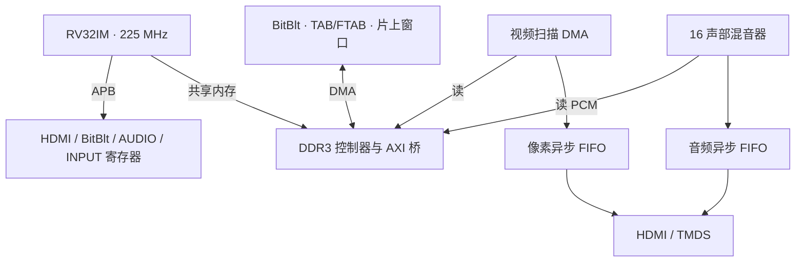

# 01 — 系统架构、时钟与存储规划

**对应技术报告：** 第二部分 2.1、2.2.3.1～2.2.3.3、2.3.1。**工程入口：** [顶层 RTL](../rtl/ddr3_example_top.v)、[工程 XML](../par/ddr_demo_ti60/ddr_demo_ti60.xml)、[PERI](../par/ddr_demo_ti60/ddr_demo_ti60.peri.xml)、[SDC](../par/ddr_demo_ti60/sdc/ddr3.sdc)。

## 系统边界

Ti60F225 上的 Sapphire RV32IM 处理器负责输入解析、游戏/负载状态、提交命令表和帧级调度。专用 BitBlt RTL 读取 DDR 中的命令与源图，完成复制、填充、色键和透明合成；HDMI 扫描 DMA 与音频混音器在各自节拍持续消费数据。外部 DDR3 同时包含固件、对象表、图像/PCM 素材、帧缓冲和分带命令桶。

## 时钟域与复位

| 域 | 既有配置 | 主要模块 | 复核入口 |
|---|---:|---|---|
| 板级参考 | 25 MHz | PLL | PERI |
| `core_clk` / `user_clk` | 225 MHz | CPU、BitBlt、混音与 APB | 顶层、PERI |
| `pll_fb_clk` | 100 MHz | DDR 访存控制侧 | DDR IP/PERI |
| `sdram_clk` | 400 MHz | DDR PHY | DDR IP/PERI |
| `hdmi_tx_slow_clk` | 74.375 MHz | 扫描和音频数据岛 | 顶层、PERI |
| `hdmi_tx_fast_clk` | 371.875 MHz | 10:1 TMDS 串行传输 | 顶层/PERI |
| PCM 消费 | 48 kHz | HDMI 音频通路 | hdmi_island.v |

显示总时序 1650×750；`74,375,000/(1650×750)≈60.10 Hz`。**225 MHz 核心频率、游戏目标 60 tick/s、渲染 FPS、呈现 FPS 和显示刷新率不可混用。**跨域数据使用专用 FIFO；控制信号和复位同步须分别审查，不能因为“都是 225 MHz SoC”就省略 CDC 验证。

## 地址与共享内存

| 地址范围/基址 | 用途 | 代码依据 |
|---|---|---|
| `0x00001000` 起 | 固件/数据/BSS/栈的低 15 MiB 区域 | [game.ld](../par/ddr_demo_ti60/embedded_sw/soc/software/standalone/game/game.ld) |
| `0x01000000`、`0x01200000`、`0x01400000`、`0x01C00000` | 四块 RGB565 帧缓冲 | [main.c](../par/ddr_demo_ti60/embedded_sw/soc/software/standalone/game/src/main.c) |
| `0x02000000` | PCM 声音段 | game.ld |
| `0x03000000` | 分带命令 bin | [blit.h](../par/ddr_demo_ti60/embedded_sw/soc/software/standalone/game/src/blit.h) |
| `0x04000000` | 运行时图形解压区 `.artbss`（NOLOAD） | game.ld |
| `0x06000000` | 压缩图形素材段 `.bg_assets` | game.ld |

每幅 1280×720 RGB565 帧缓冲需要 `1,843,200 B`；软件须避开扫描帧、待翻页帧以及仍由 BitBlt 写入的帧。实际对象表、素材和命令桶大小以链接脚本及固件宏为准，不能仅凭此摘要重新规划 DDR。

## 主要硬件接口

| 接口 | 作用 | 首选源码 |
|---|---|---|
| APB3 | 状态寄存器、模式配置、启动 | `blit_engine.v` / `hdmi_fb.v` / `audio_mixer.v` |
| AXI4 | 访存读写、Burst、返回响应 | `blit_axi_wide.v` / `blit_axi_rd_arb.v` |
| TMDS | 像素与音频数据岛编码 | `hdmi_island.v` |
| GPIO/UART | 4×4 矩阵与 CH9350、上位机 | `input_hub.v` |

报告说明的是集成架构；项目中存在厂商 SoC、DDR PHY、示例编码模块，它们与本项目新增 RTL 的权属应按源码原有说明划分。
