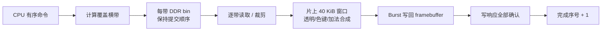

# 02 — BitBlt 图形引擎：命令、分带与缓存

**对应报告：** 2.2.3.4.1～2.2.3.4.4。**核心 RTL：** [blit_engine.v](../rtl/blit/blit_engine.v)、[blit_axi_wide.v](../rtl/blit/blit_axi_wide.v)；**固件：** [gfx_hw.c](../par/ddr_demo_ti60/embedded_sw/soc/software/standalone/game/src/gfx_hw.c)、[blit.h](../par/ddr_demo_ti60/embedded_sw/soc/software/standalone/game/src/blit.h)。

## 数据路径与命令发布

1. CPU 侧 `GfxOps` 统一接口保留软件绘制和硬件绘制两种后端。
2. 硬件后端可直接写 APB 绘图寄存器，也可在 DDR 中编码命令列表（LIST）；`SLOT/DRAW` 复用精灵参数，`TAB` 批量读取精灵绘制表，`FTAB` 批量读取矩形填充表。
3. 硬件取回指令并生成规范化像素任务，按功能和对齐约束进入三类数据通路。
4. 队列提交与 GPU 完成是两件事。对表项内存和 framebuffer 的复用必须遵循完成序号/等待协议。

| 执行通路 | 适用操作 | 峰值能力 / 限制 |
|---|---|---|
| 普通像素路径 | 拷贝、色键、A8 像素掩码 | 支持不适用并行路径的混合与裁剪 |
| 宽突发路径 | 对齐的大面积不透明填充/复制 | 128-bit / beat，理论 8×RGB565 |
| K 分带路径 | 缓存命中精灵、填充、全局 Alpha、加法合成 | 某些条件下 8 像素/拍；不应把峰值当作整帧持续吞吐 |

### 分带机制

720p 画面切为 45 个 `1280×16` 带，每带窗口 `1280×16×2=40,960 B`（40 KiB）。

一条跨带指令会进入多个带的 bin。**实现代价**是分桶与 bin 读写；**主要收益**是重叠区域在片上完成多次混合，减少 DDR 目标像素读改写。带内从清零开始，所以背景应显式绘制；命令原始顺序不能被分桶改变。

### 片上源缓存

16 KiB、512 行×32 B、直接映射。弹幕小精灵重复读取时命中可减少 DDR 源读取，未命中才进行突发填充。CPU 改写贴图后，必须先完成 CPU 写入可见性处理，再使 BitBlt 缓存相关行失效；不能假定硬件监听 CPU 写。

### 需要验证的边界条件

| 场景 | 主要风险 | 对应断言/测试思路 |
|---|---|---|
| 精灵跨屏裁剪 | 行起始和源地址偏移错误 | 与 CPU backend 像素逐点比较 |
| 透明物体重叠 | 命令乱序、重复读改写 | 同一覆盖区域多命令，检查颜色 |
| bin 容量耗尽 | 命令丢失或覆盖 | 检查溢出标志与回退 |
| TAB 生命周期 | CPU 提前覆盖表项 | 等待完成序号后才复用表 |
| 缓存失效 | 旧纹理被重复使用 | CPU 更新纹理 + 显式失效测试 |
| 四缓冲交替 | 尚未完成帧被 HDMI 扫描 | 完成确认之后再发翻页请求 |

当前仓库没有声称这些场景全都具备独立自动化 RTL Testbench。参见 [07 验证](07_VERIFICATION.md)的覆盖矩阵。
