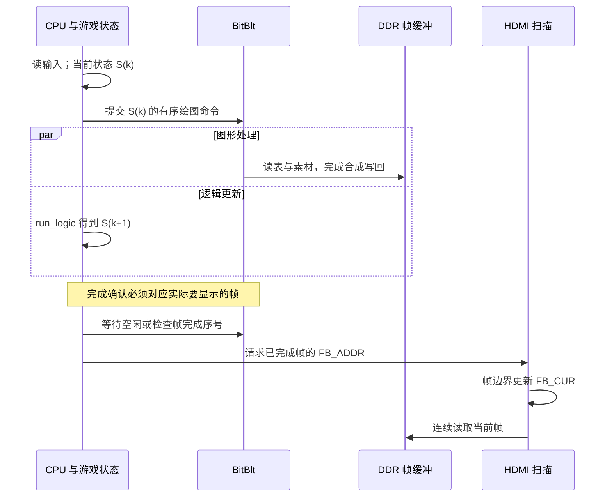

# 从输入到 HDMI：关键源码追踪与设计取舍

本文配合 [README](../README.md) 的第 5～11 章使用。首页按 12 步建立全局理解，这里继续追踪具体函数与数据生命周期，适合答辩追问或接手代码时阅读。内容对应当前 225 MHz 交付版本，代码链接指向本仓库文件。

**建议阅读顺序：**[一帧的交接](#frame-handoff) → [有序 TAB 裁剪](#ordered-tab) → [字体路径](#text-path) → [透明混合与 DDR](#alpha-ddr) → [音频节拍](#audio-cadence) → [测量与版本](#measurement)。

<a id="frame-handoff"></a>
## 1. 一次输入怎样变成新画面

先看 [main.c 的主循环][main-loop]。这里同时管理三个不同的完成状态：

| 状态 | 代码中的依据 | 已经保证什么 |
| --- | --- | --- |
| 命令提交结束 | `gfx_end()` | 当前帧的命令组织结束；引擎可能仍在读表和写像素 |
| 绘制完成 | `blit_wait()`或`blit_band_done(pend_seq)` | 对应工作已由引擎完成，可进入呈现流程 |
| 新缓冲被扫描 | `hdmi_cur()` / `FB_CUR`变化 | HDMI 已接收对应缓冲作为扫描来源 |

默认启用 `overlap`时，CPU 先描述当前游戏状态，再更新下一次状态。输入虽然已经读到，但逻辑更新结果通常体现在随后提交的画面中。为清楚表示这一点，下图用 S(k) 和 S(k+1)区分状态：



分带流水允许 CPU 提交当前帧时，上一帧仍在引擎中处理。这时循环末尾等待的可能是 `pend_fb`指向的上一帧，不能把“等一次引擎”简单理解成“当前刚提交的帧立即显示”。

### 1.1 为什么有四个帧缓冲

选择写入地址时，代码排除：

- `hdmi_cur()`：显示器正在扫描的帧；
- `last_req`：最近请求显示、可能还未完成交接的帧；
- `pend_fb`：引擎仍可能在写的帧。

这三个地址可能重合，也可能不同。第四块缓冲提供可写空间；四缓冲的价值是允许正确重叠，不是将速度直接乘四。

### 1.2 CPU 与图形引擎的缓存不是同一个缓存

[硬件后端发布函数][hw-publish]先执行存储顺序屏障，再失效图形引擎源缓存，必要时发布命令列表。目的分别是让新数据按顺序可见、避免引擎继续使用旧源图、让引擎得到可执行命令。

当软件从硬件后端切换为 CPU 绘图时，还要处理 CPU 数据缓存中可能陈旧的帧缓冲内容。CPU D-cache、图形源缓存和命令完成等待承担不同职责，不能用其中任意一个动作替代其余动作。

<a id="ordered-tab"></a>
## 2. 为什么“批量列表”仍可能提交很慢

### 2.1 沿真实后端调用追踪

| 前端接口 | 后端行为 | CPU 是否逐项展开 |
| --- | --- | --- |
| `gfx_blit_list()` | `hw_copy_list()`；LIST/WORD 下进入 `hw_copy_list_hw()`写 DRAW，APB 下写寄存器 | 是 |
| `gfx_blit_table()` | `hw_table()`配置精灵槽，写 TAB 和表地址，让硬件读原表 | 支持该操作时不展开每个表项 |
| `gfx_blit_table_clipped()` | 将连续屏内切片交给上一个接口，边缘项用单项裁剪 | 屏内段走能力检查后的 TAB；裁剪项单独处理 |

代码入口为 [gfx.c][gfx-batches] → [gfx_hw.c][hw-list] → [hw_table()][hw-table]。判断性能时必须读到这个层级，不能只看前端名字里是否有 `list`或是否已分段。

一条 TAB 记录包含数量及表地址；精灵槽定义、上下文、列表容量与发布仍有开销。它减少的是 CPU 重复解释位置表的成本，不是让 N 个精灵变成零成本。

### 2.2 只在原顺序上切段

假设透明精灵 A、B 在屏内，C 跨过边缘，D、E 又在屏内：

```text
正确：TAB(A,B) → 裁剪 C → TAB(D,E)
错误：TAB(A,B,D,E) → 裁剪 C
```

后者把 C 移到最上层，遮挡和混合结果可能变化。当前 [gfx_blit_table_clipped()][clipped]保留画家顺序，遇到边缘项先交出前面的屏内段，再调用原单项 helper。完全出屏时，原裁剪流程直接不画。

判断条件使用当前目标大小和每个精灵的真实宽高，不以 1280×720 或 25 px 作为通用接口的固定条件。每段像素统计单独累计并清零。表项的精灵索引仍要求调用者提供合法值；该接口不是任意输入表的校验器。

每段继续调用 `gfx_blit_table()`，由它和后端检查 LIST 模式、TAB 能力、精灵槽数、地址对齐及可表示的目标范围。如果不支持，回退到原列表路径；不能仅凭函数指针非空就假设硬件能够执行。

### 2.3 保留整表快速路径与透明语义

[draw_seeds()][draw-seeds]先尝试取得游戏逻辑已经维护的稳定绘制表：

1. 整表在目标内：直接一次 `gfx_blit_table()`，避免第二次逐项检查。
2. 有裁剪项：调用有序裁剪接口。
3. 普通战役的半透明敌弹：使用 `gfx_blit_table_alpha()`或相应裁剪版本，保持全局透明度。
4. 稳定表不可用：使用原先反复填充的 128 项列表路径。

色键表示跳过特定颜色；全局 Alpha 表示整幅对象使用同一强度；A8 表示逐像素的独立透明度。它们不是同一种数据格式。当前非 Alpha 批量接口沿用其原有语义，不能因 `Sprite`中带有 A8 指针就宣称 TAB 已支持该掩码。

### 2.4 为什么不能把临时数组直接交给 TAB

`seed_list[128]`在 CPU 循环中很快会被下一批对象覆盖。列表展开会把需要的参数写成命令，而 TAB 只把原数组地址交出去；函数返回时硬件可能尚未读取该数组。

当前稳定路径引用 [Game.seed_draw][seed-buffers]的三张轮换表，[game_tick()][seed-build]写下一张。主循环控制在途帧和完成等待，使旧表在使用期间不被轮换覆盖；精灵描述及像素存储也必须保持有效。这里的“三张”依赖当前逻辑与帧流水深度，不能推广成任何异步系统都只需三个缓冲。

解释这项优化时，可以直接说：

> 大部分屏内弹幕继续让硬件读表，只有真正跨边缘的对象需要 CPU 裁剪；顺序不变，原表也一直保留到硬件用完。

<a id="text-path"></a>
## 3. 当前字体为什么不同文字会有不同成本

[字体入口位于 gfx.c][font-entry]，不是另一套外部 UI 框架。

### 3.1 字形和整串标签是两层缓存

- **ASCII 字形层：**原 5×7 位图保留。满足倍率条件时构造色键图集，较大倍率用合并笔画填充。
- **中文字形层：**按需要取得预生成的中文 A8 数据，配合对应颜色平面绘制。
- **整串标签层：**在萝卜 HUD/菜单区启用 `gfx_text_cache(1)`；内容、颜色和倍率匹配时，将整串作为小图复用。纯 ASCII 标签仍用色键，含中文标签用 A8。

标签缓存为 32 组、每组 4 项；RGB565 像素池为 96K 像素，A8 池为 192 KiB，每个标签最多 16,384 像素。最近 8 个渲染帧使用过的标签受到覆盖保护；无可用位置或不满足条件时，当前调用回到逐字绘制。该帧数策略也依赖现有主循环对在途工作量的约束。

标签缓存只在明确开启的绘制区间生效，不应描述为所有场景中的所有文字都自动缓存。

### 3.2 语言切换修复保留了什么

翻译查询按字符串内容计算哈希，并对词典字符串做校验，避免临时缓冲地址复用造成旧翻译命中。切换语言时先等待图形工作完成，再重置字形相关缓存；中文掩码和颜色平面需要一起预留，避免分配其中一个时使另一个指针失效。

这些修复与恢复 ASCII 旧路径可以同时存在。中文仍需要自己的字形数据，不能把“回退字体路径”理解成删除中文支持。

### 3.3 怎样解释十几毫秒的 HUD 峰值

[render_game()][hud-scope]里的 HUD 计时从 HUD 开始，包含相关技能横幅、菜单、升级和统计界面，结束时才写 `render_split.hud`。这段时间可能包括字体创建、标签重建、其他精灵、矩形以及提交等待。

可以按以下方式组织下一次板上实验，而不是直接下结论：

1. 固定同一画面、同一语言、同一 Debug ELF，记录连续稳定窗口。
2. 再记录切语言、换颜色/倍率、数值更新、打开升级菜单各自的窗口。
3. 同时看 `hud_us`、`submit_us`与等待时间，区分一次性构建和持续成本。
4. 若需要纯文字成本，再针对该区间增加实际计数或定点计时；当前占位字段不具备这种能力。

`main.c`目前把 `font_hit/font_miss/font_reset/label_hit/label_miss/font_pixels`固定输出为零。文档保留这一事实，避免读者用零值证明或否定缓存效果。

<a id="alpha-ddr"></a>
## 4. 透明效果为什么同时影响画面和带宽

透明混合需要已有目标颜色：读取源颜色与透明度，取得背景，混合后保存。多层对象逐次访问 DDR 目标颜色会增加流量；片上 16 行窗口让当前带的目标颜色留在片上，叠加完后统一写回。

```text
多个源对象 → 当前 1280×16 RGB565 窗口 → 该带最终像素 → DDR 帧缓冲
                  按原绘制顺序混合
```

单个窗口为 40,960 B。它减少的是目标读改写；源图、A8 掩码、命令 bin、最终写回、CPU 与 HDMI 扫描仍需带宽。跨多个带的对象还会增加 bin 与重复处理成本。

三种优化各有边界：

| 设计 | 适合的情况 | 仍然存在的成本 |
| --- | --- | --- |
| 源缓存 | 小精灵和字形反复出现 | 未命中、冲突与新素材发布 |
| TAB / FTAB | 大量规则对象、已有稳定表 | 硬件读表、分带归类、对象像素 |
| 分带窗口 | 多层透明叠加 | 每带管理、源读取、命令流及最终写回 |

当前 K 路径可在满足条件时并行处理 8 像素，全局 Alpha 和加法可使用该路径；A8 等操作使用其他路径。不要把“支持 Alpha”自动解释成“所有 Alpha 格式都同速”。

主机侧 C 参考混合还使用量化后的 5 位透明度计算，而硬件可使用 8 位。因此主机渲染预览能展示构图、资源与状态，不独立证明硬件逐像素完全一致，也不能给出板上帧率。

<a id="audio-cadence"></a>
## 5. 为什么核心升到 225 MHz，声音仍按 48 kHz 播放

调用链从 [game_sound_tick()][game-sound]的事件位开始，经 [audio.c][audio]选择声音库条目、配置声部，最终到 [audio_mixer.v][mixer]取样、插值、混音和饱和输出。

核心侧通过 FIFO 水位决定何时补样本。HDMI 像素侧按采样节拍消费，当前 ACR 为：

```text
fs = 74,375,000 × 6,144 / (128 × 74,375) = 48,000 Hz
```

提高核心处理预算不会自动把 22.05 kHz 母版以更快速度播放。软件时基错误仍可能让技能或事件调度时间不对，因此应分别检查供样、播放节拍和事件时钟。

语音组织也有上层约束：当前声音库的三段大招和七段 Boss 语音共享一套单旁白调度，Boss 优先；同时释放多人大招时轮换谁发声，动画仍可同时进行。BGM 音量在语音期间降低。

最新位流的两项同步修复分别位于：

- [hdmi_island.v][sb6]：音频包 SB6 的左右声道 PCUV 位排列；
- [hdmi_fb.v][vsync]：外部 VSYNC 边沿使用 `vs_tx0`，内部 DMA 保持 `vs0`。

仿真记录中的参考一致性和实际显示器是否正常发声是两类证据。现有 HDMI 摘要覆盖指定仿真条件，未包含接收端实板音频验收结果，不能由此推断所有接收端的兼容性。

<a id="measurement"></a>
## 6. 如何把实现说明变成可复查的结果

### 6.1 先固定版本，再谈性能

[CURRENT_RELEASE.json](../CURRENT_RELEASE.json)将当前 BIT、两份 ELF、声音库摘要和软件源码摘要放在一起。讲解前至少能回答：用的是哪份 BIT、哪份 ELF、Debug 还是 Release、当前 `core_hz`是多少。

现有证据记录的核心 setup 为 +0.063 ns、hold 为 +0.012 ns。它们属于选定的 225 MHz 实现，余量较小；不能单凭这个点推出“最高无违例频率”或“刚好违例的下一档”。本仓库未附完整的 225/250 MHz 扫频对照，频率上限应另以对应约束、实现配置和报告为依据。

### 6.2 区分四类“数量”

| 名称 | 示例 | 如何解释 |
| --- | --- | --- |
| 对象池容量 | 敌弹 32,768 槽 | 能存多少对象 |
| 请求目标 | 25 px 弹幕 11,000 | 上位机希望产生的负载 |
| 实际活跃/绘制数 | 每个窗口由固件报告 | 当时实际工作量 |
| 稳定性能上限 | 固定条件下持续达标的最高负载 | 需要测量，不能由前面三项代替 |

同样要区分 `render_fps`、`logic_hz`、`present_fps`和`scan_hz`。扫描可以重复旧帧；渲染也可以比显示更快。画面连续与新画面及时到达，需要一起看呈现和重复情况。

### 6.3 以同一测量窗口解释一次变化

现有遥测使用相同 `seq`关联 `M4/F4/P4/C4`，配置变化另有 `epoch`。最有说服力的演示是：

```text
应用固定预设 → ACK → 实际状态匹配 → 新窗口稳定
→ 记录目标/实际数量与呈现 → 只改变一个条件 → 再记录相同指标
```

Debug 的提交统计会扣除 `qstall`；Release 简化统计不单独扣除。它们不是同一口径的纯 CPU 提交时间。FIFO 欠流计数需要看测量窗口内的增量，不能把其他实验遗留的累计值计入当前窗口。

### 6.4 资源增长也要看链接布局

当前发布清单记录 `.artbss`使用 33,475,968 B，而该区预留 32 MiB，剩余 **78,464 B**。余量对应发布清单中的 ELF；资源变更后应重新查看链接结果。继续增加大尺寸动画、字体缓存或解压素材前，需要检查链接报告和区域布局，不能只用整个 DDR 的容量判断是否还有可用空间。

普通重建使用现有派生资源；改母图或 WAV 才需要重新生成对应数据。完整步骤见 [README 第 12 章](../README.md#deployment)。

[main-loop]: ../par/ddr_demo_ti60/embedded_sw/soc/software/standalone/game/src/main.c#L2104
[hw-publish]: ../par/ddr_demo_ti60/embedded_sw/soc/software/standalone/game/src/gfx_hw.c#L98
[gfx-batches]: ../par/ddr_demo_ti60/embedded_sw/soc/software/standalone/game/src/gfx.c#L124
[hw-list]: ../par/ddr_demo_ti60/embedded_sw/soc/software/standalone/game/src/gfx_hw.c#L135
[hw-table]: ../par/ddr_demo_ti60/embedded_sw/soc/software/standalone/game/src/gfx_hw.c#L252
[clipped]: ../par/ddr_demo_ti60/embedded_sw/soc/software/standalone/game/src/gfx.c#L194
[draw-seeds]: ../par/ddr_demo_ti60/embedded_sw/soc/software/standalone/game/src/render.c#L556
[seed-buffers]: ../par/ddr_demo_ti60/embedded_sw/soc/software/standalone/game/src/game.h#L133
[seed-build]: ../par/ddr_demo_ti60/embedded_sw/soc/software/standalone/game/src/game.c#L1072
[font-entry]: ../par/ddr_demo_ti60/embedded_sw/soc/software/standalone/game/src/gfx.c#L438
[hud-scope]: ../par/ddr_demo_ti60/embedded_sw/soc/software/standalone/game/src/render.c#L1084
[game-sound]: ../par/ddr_demo_ti60/embedded_sw/soc/software/standalone/game/src/game_sound.c#L45
[audio]: ../par/ddr_demo_ti60/embedded_sw/soc/software/standalone/game/src/audio.c
[mixer]: ../rtl/audio/audio_mixer.v
[sb6]: ../rtl/hdmi/hdmi_island.v#L320
[vsync]: ../rtl/hdmi/hdmi_fb.v#L150
